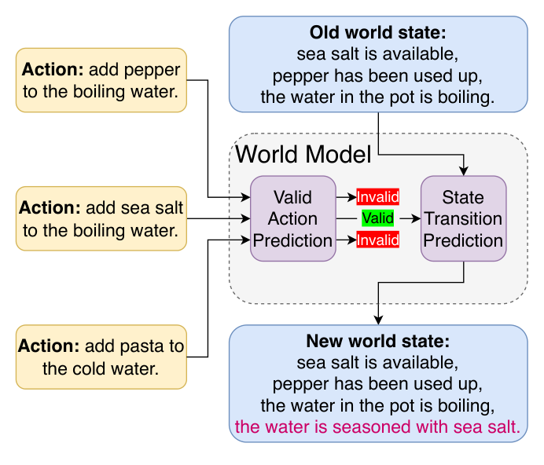
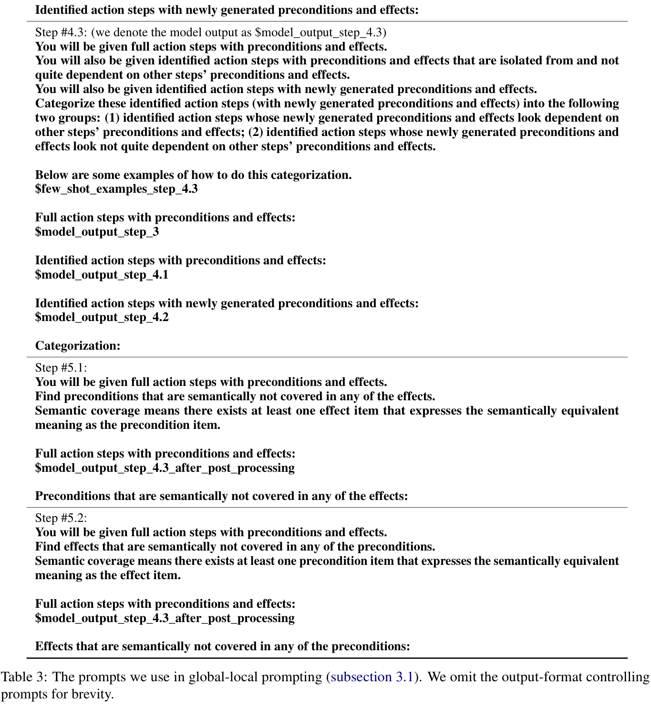
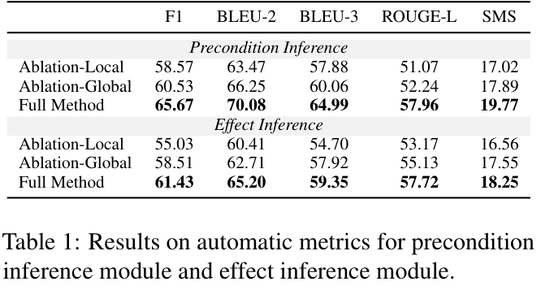
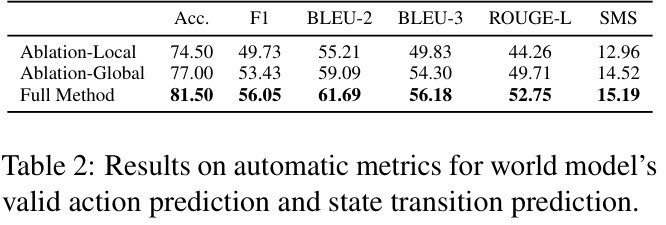

# PEWM：用 Precondition / Effect 把 LLM 改造成 World Model

## 元信息

- **标题（原文精确）**：Making Large Language Models into World Models with Precondition and Effect Knowledge
- **作者**：Kaige Xie, Ian Yang, John Gunerli, Mark Riedl
- **单位**：School of Interactive Computing, Georgia Institute of Technology
- **发表 venue（已核对 PDF 首页与元数据）**：**COLING 2025**（The 31st International Conference on Computational Linguistics），2025-01-19 ~ 01-24，ACL 版权页，**pp. 7532–7545**。PDF metadata 的 subject 字段为 `coling 2025`。
  - ⚠️ **修正任务书里的两处信息**：(1) 本文**不是** NeurIPS / NeurIPS workshop 论文，是 COLING 2025 主会长文；(2) 第一作者是 **Xie（Kaige Xie）**，不是 Liu；(3) 正确的 arXiv id 是 **arXiv:2409.12278**（v1 2024-09-18, v2 2024-10-02），任务书给的 2405.18417 指向另一篇物理化学论文。ACL Anthology: `2025.coling-main.503`。
- **代码 / 数据可用性**：**未公开释出**。14 页 PDF 正文与附录中**没有任何 code 仓库链接**，仅有三个脚注链接（Prolific、`google/flan-t5-large`、`huggingface/transformers`）；arXiv abstract 页亦无 repository URL。语料（precondition/effect corpus）与 prompt 全文在 Appendix B/C 以 Table 3、Table 4 给出，可据此复现 prompt，但 action plan 数据本身 **待核对**。
- **⚠️ 与 TWAM 假设的关键差异**：本文**完全没有 VLM、没有机器人、没有真实环境交互、没有像素/传感器输入**。所有模块都是纯文本 LLM：GPT-4 用于数据生成与语义匹配，FLAN-T5-large 微调用于 precondition/effect 推理，GPT-4o 用于语料重构与匹配统计。

## 一句话总结

把 world model 的两个职责拆开——**用微调 FLAN-T5 预测 action 的 precondition 与 effect（自然语言短句集合），再用 GPT-4 做"语义覆盖/语义矛盾"判定**，从而以 first-principles 方式（而非直接学 $P(s'|s,a)$ 的映射）同时获得 valid action prediction（Acc. 81.50）与 state transition prediction（F1 56.05），并通过 human study 验证其知识与人类 world understanding 对齐（precondition 77% / effect 70% / 状态转移 63%）。

## 问题设定

### 论文对"naive LLM-as-world-model"的诊断

论文引 Valmeekam et al. 2023 / Wang et al. 2024 / Pan et al. 2024 / Chambers et al. 2024，指出 LLM 作为 world model 的通用答案是"不行"，但给了一个 nuance：LLM 训练文本里隐含了真实世界物理规律（水烧开、物体会下落、捏刹车会停车），所以**能生成貌似合理的解释（plausible span of text）≠ 理解该现象**；一旦问到 novel situation 或 training distribution 之外的现象组合就失效。处方不是让 LLM 直接输出 $s'$，而是**逼它输出两种可检查的中间结构**（precondition / effect），再用外部匹配逻辑组装 world model。作者观察到 GPT-4 / Gemini 1.5 Pro / Claude 3.5 Sonnet 都能可靠回答"某动作可执行需要什么为真"和"某动作想改变什么"——即这类知识**内在存在（intrinsic knowledge）但在生成 plan 时不一定被 apply**，需要专门的 prompt 技术诱导出来。

### 两种 failure mode（Figure 1）



*（原文 Figure 1, p.1）*

Figure 1 用煮面场景把 world model 的两项必需能力画成一条流水线，两类错误**互相独立**：

1. **Invalid action prediction（动作筛选失败）**——给定 old world state（`sea salt is available, pepper has been used up, the water in the pot is boiling`），模型须判断动作可否执行。图中 `add sea salt to the boiling water` → **Valid**；`add pepper to the boiling water` 表面合理但 state 明写 **pepper has been used up**（前置条件不满足）→ **Invalid**；`add pasta to the cold water` 的水温（cold）与 state（boiling）不符 → **Invalid**。即"没把 precondition 与 state 对齐就放行动作"。
2. **Invalid state transition prediction（状态更新失败）**——即便动作合法，$s'$ 也必须正确。图中新 state 正确地把 `the water is seasoned with sea salt`（水已被海盐调味）作为**新增**项加入，同时**保留**未受影响的旧事实。典型失败：该删的不删（`pepper has been used up` 一直残留）、该加的没加、或把整段 state rewrite 成语义漂移的新描述。

论文强调两个 task 都成立才叫 world model：**(1) "can this action be performed at this time?" (2) "how the world is different if it were to be performed?"**。并指出先前工作（Ammanabrolu & Riedl 2021a，KG-based text world model）**直接建模 state↔action 映射**、忽略 precondition/effect，因而**牺牲 interpretability**——高利害场景下开发者需要知道"为什么这个动作被判可行"。这就是本文选择 first-principles 分解的动机：先把两个复杂预测任务拆到最小元素（precondition、effect），再自底向上重组。

### 核心领域概念：action chaining

全文方法与数据构造都围绕 **action chaining**（动作间强依赖）：要执行某动作，通常必须先执行若干动作把 world state 布置好。作者主张真实世界域（做菜）比既有工作关注的 fictional domain（文字冒险游戏）**chaining 程度高得多**、更难建模。从 P/E 视角，chaining 被定义为一种**双向覆盖**关系：多数动作的 precondition 被**其它动作的 effect 覆盖**，反之亦然。这个"覆盖"概念随后直接变成数据过滤器与评测判据。

## 方法

### 总体架构与形式化

World model = 两个子模块：**§3.1 Precondition/Effect Inference Module**（微调**两个独立的 FLAN-T5-large**，一个只出 precondition、一个只出 effect）+ **§3.2 Semantic State Matching Module**（**两个独立的 GPT-4 prompt 模块**，不训练）。

⚠️ **论文正文没有任何编号公式**（唯一数学记号是 intro 里的 $P(s'|s,a)$）。下列记号是我按其 §3.1–3.3 叙述与 Appendix C 的 prompt 语义**重写的形式化**，不是原文公式。动作 $a$ 与世界状态 $s$ 都是**自然语言句子的集合**（item 化描述），不是符号谓词。Precondition 定义为 **"the state that must be made true before action execution"**，Effect 为 **"the state achieved after action execution"**：

$$\mathrm{Pre}(a)=\{p_1,\dots,p_m\},\quad \mathrm{Eff}(a)=\{e_1,\dots,e_k\};\qquad f_{\text{pre}}(a)\to\mathrm{Pre}(a),\ \ f_{\text{eff}}(a)\to\mathrm{Eff}(a)$$

- **Valid action prediction（覆盖式硬门）**：$\mathrm{Valid}(a,s)=\mathbb{1}\big[\forall p\in \mathrm{Pre}(a),\ \exists\, x\in s:\mathrm{cover}(x,p)\big]$。$\mathrm{cover}(x,p)$ = "存在至少一个 world-state item 与该 precondition item 语义等价"，由 GPT-4 判定，**全部覆盖才返回 TRUE，否则 FALSE**（Appendix C 原话）。
- **State transition prediction（add/delete 更新）**：$\mathrm{Add}(a)=\mathrm{Eff}(a)$，$\mathrm{Del}(a,s)=\{x\in s:\exists\, e\in \mathrm{Eff}(a),\mathrm{contradict}(x,e)\}$，$$s'=(s\setminus \mathrm{Del}(a,s))\ \cup\ \mathrm{Add}(a)$$ $\mathrm{contradict}$ 亦由 GPT-4 判定；Appendix C 的第二个 prompt 只要求**输出矛盾项**，删除集由程序取并集。

### Precondition / Effect 如何"获得"：Global-Local Prompting

没有面向高 chaining 域的现成 P/E 语料、人工标注又贵，作者**用 GPT-4 自动蒸馏语料**，五步（prompt 全文见 Appendix B Table 3, p.13，图：）：

| Step | 作用 | 关键约束 |
|---|---|---|
| **#1** 全局生成 | 让 GPT-4 给出某任务的完整 action plan | "steps must have a strong dependency on each other"、"grounded in a specific concrete environment" |
| **#2** 局部丢弃+补步 | few-shot 提示丢弃与其它步孤立、chaining 潜力不足的步；若不连贯可**新增**强依赖步补位 | 新增步必须强依赖其它步 |
| **#3** 同时出 P/E | 对每一步**独立地** infer 全部 precondition 与 effect（可多句） | ⚠️ prompt 明写 **"there is no need to make the precondition of step N identical to the effect of step N-1"**——不强制字面闭合，避免模型只是复制粘贴 |
| **#4** 局部修补（#4.1/#4.2/#4.3） | #4.1 找出 P/E 与其它步不 chained 的步；#4.2 对其**一次性重新生成** P/E；#4.3 把重生成结果二分类（已依赖 / 仍不依赖）并选择性丢弃 | 只重生成一轮 |
| **#5** 全局过滤（#5.1/#5.2） | 把一个 sample 的全部 precondition 与全部 effect 分别喂 GPT-4，输出"未被对方集合覆盖"的项，算**未覆盖率百分比** | **过滤掉百分比最高的 5%** |

命名理由：#2/#4 是**逐个动作步的局部检查**（local），#5 是**整条 plan 的全局视角**（global）；由于一个 sample 就是一串步骤，sample 过滤等价于批量丢步。作者把该流程跑**数千次**，得到 **2000+ 条 action plan**，平均每条约 **20 个 action step**。

### 推理流水线（Inference Pipeline，编号步骤）

**A. Valid action prediction（给定 $s$ 与候选 $a$）**

1. $f_{\text{pre}}$（微调 FLAN-T5-large）读入自然语言动作 $a$，输出 $\mathrm{Pre}(a)$。
2. 把 $\mathrm{Pre}(a)$ 每个 item 与 world state $s$ 每个 item 一起填入 Appendix C 的覆盖判定 prompt。
3. GPT-4 逐项判该 precondition 是否被 $s$ 中至少一个 state item 语义覆盖。
4. **全部**覆盖 → TRUE（valid）；**任一**未覆盖 → FALSE（invalid）。→ 这就是 Figure 1 里拦下 `add pepper`（pepper 已用完）的机制。

**B. State transition prediction（给定 $s$ 与合法 $a$）**

1. $f_{\text{eff}}$（另一个微调 FLAN-T5-large）读入 $a$，输出 $\mathrm{Eff}(a)$。
2. 把 $\mathrm{Eff}(a)$ 与 $s$ 填入 Appendix C 的矛盾检测 prompt，GPT-4 对每个 effect item 找出 $s$ 中所有语义矛盾的 state item → 删除集 $\mathrm{Del}$。
3. $s'=(s\setminus \mathrm{Del})\cup \mathrm{Eff}(a)$：**加 effect、删矛盾项、其余原样保留**。

**C. 训练数据侧（离线，一次性）**

1. Global-local prompting 生成 plan 级 P/E 语料（2000+ plans × ~20 steps）。
2. 用该语料分别微调两个 FLAN-T5-large（pre 模型 / eff 模型）。
3. **Corpus refactoring（§4.3，GPT-4o 自动化）**：把 plan 级 P/E 转成"每个时间步的 ground-truth world state"——初始 state = 全部 precondition 的并集**减去**被该 plan 内任何 effect 覆盖的项；此后每执行一步，用该步 effect 做 state addition（addition ≡ effect 的 ground truth），再遍历旧 state 每项、让 GPT-4o 与 addition 每项比对是否矛盾、矛盾则删除 → **逐步迭代**得到每个 $t$ 的 $s_t$。

## 数据集与任务

| 项目 | 内容 |
|---|---|
| **域** | **Dish cooking（做菜）**，全文唯一评测域。选它的理由：真实世界域中 action chaining 显著、动作与状态依赖强，比 fictional domain 更难建模。 |
| **训练语料** | GPT-4 global-local prompting 自动生成，**2000+ action plans**，平均每条约 **20 个 action steps**（无人工标注）。 |
| **测试集** | 推理模块：**200 条 action plans** holdout。World model：valid action prediction 与 state transition prediction **各 200 样本**，前者**做了类别平衡**（valid / invalid 数量相等）。Search space 分析：**200 个 never-before-seen actions**。 |
| **State 的表示** | **纯自然语言描述的句子/条目集合**（"world-state items"），**不是**谓词逻辑、**不是** KG 三元组、**不是**向量。precondition 与 effect 同样是自然语言 item，因此所有比对都必须经 GPT-4 语义判定。 |
| **Ground truth 的来源** | ⚠️ **不是**真实环境模拟器，而是**从模型自己那套 GPT-4 生成的 P/E 反向重构**（见 pipeline C.3，GPT-4o 执行）。评测的"真值"与训练数据同源。 |
| **Human evaluation 设置** | Prolific 平台，IRB 已批准；先答 screening question 并**人工核验**、剔除不合格者；要求**身在美国、英语为母语**；每轮使用**完全不重叠**的标注者；一致性用 **Fleiss's kappa**，各轮均为 **moderate**（论文只给定性等级、未给 kappa 数值 → 待核对）。 |

## 实验与结果

### 4.1 Global-local prompting 的语料质量（human study）

| 维度 | 设置 | 结果 |
|---|---|---|
| **Reliability**（P/E 是否合理） | 随机 30 个 action sample，每个由 **5 名**标注者独立判断，**majority vote** 定论 | **93%** 被认为 reasonable（moderate agreement） |
| **Informativeness**（chaining 是否显著） | 随机 30 个 action plan sample；判据：是否存在**超过 2 个 step**（约占全 plan 步数 **10%+**）的 P/E 从未被其它 step 覆盖 | **87%** 被认为有 significant action chaining |
| **Step #2 & #4（local discard）有效性** | 随机 30 个被丢弃 step（**15 个来自 #2（无 P/E）+ 15 个来自 #4（有 P/E）**），连同原 plan 给标注者判是否"未 chained" | **73%** 确实未与其它 step chained |
| **Step #5（global filter）有效性** | 30 个被过滤 plan + 30 个保留 plan → 配成 **30 个 filtered-kept pair**，判 filtered 是否 chaining 明显更少 | **80%** 的 pair 中 filtered 确实更差 |

（#1 与 #3 被视为 foundational step，其质量已被 reliability / informativeness 隐式测量，故不单独消融。）

### 4.2 Precondition / Effect Inference Module（Table 1）



*（原文 Table 1, p.6）*

模型：两个 **FLAN-T5-large**（`google/flan-t5-large`），AdamW，**学习率从 5E−5 线性衰减**，**50 epochs**，单张 **NVIDIA TITAN Xp**，推理 **greedy decoding**（Appendix A）。指标：token-level **F1**、**BLEU-2**、**BLEU-3**、**ROUGE-L**、**SMS**（sentence mover's similarity）。

| 任务 | 配置 | F1 | BLEU-2 | BLEU-3 | ROUGE-L | SMS |
|---|---|---|---|---|---|---|
| Precondition Inference | Ablation-Local | 58.57 | 63.47 | 57.88 | 51.07 | 17.02 |
| | Ablation-Global | 60.53 | 66.25 | 60.06 | 52.24 | 17.89 |
| | **Full Method** | **65.67** | **70.08** | **64.99** | **57.96** | **19.77** |
| Effect Inference | Ablation-Local | 55.03 | 60.41 | 54.70 | 53.17 | 16.56 |
| | Ablation-Global | 58.51 | 62.71 | 57.92 | 55.13 | 17.55 |
| | **Full Method** | **61.43** | **65.20** | **59.35** | **57.72** | **18.25** |

消融定义：**Ablation-Local** = 训练时跳过 #2 与 #4；**Ablation-Global** = 跳过 #5。Full 相对 Ablation-Local 的增益：precondition F1 **+7.10**、SMS **+2.75**；effect F1 **+6.40**、BLEU-2 **+4.79**、SMS **+1.69**。两个全局/局部步骤都被判为 necessary and beneficial。

**Human eval（§4.2）**：随机 30 个模型预测 precondition + 30 个模型预测 effect，问标注者是否"reasonable 且符合自身 commonsense"→ **77% precondition、70% effect** 与人类 world model understanding 一致（moderate agreement）。

### 4.3 World Model 整体（Table 2）



| 配置 | Acc. | F1 | BLEU-2 | BLEU-3 | ROUGE-L | SMS |
|---|---|---|---|---|---|---|
| Ablation-Local | 74.50 | 49.73 | 55.21 | 49.83 | 44.26 | 12.96 |
| Ablation-Global | 77.00 | 53.43 | 59.09 | 54.30 | 49.71 | 14.52 |
| **Full Method** | **81.50** | **56.05** | **61.69** | **56.18** | **52.75** | **15.19** |

⚠️ **表格结构提示（已核对 PDF p.7 版式）**：Table 2 是**一张扁平表**，不像 Table 1 那样用 "Precondition Inference / Effect Inference" 分块小标题。caption 写的是 "for world model's valid action prediction **and** state transition prediction"。结合 §4.3 正文（valid action prediction 用 **Acc.**；state transition prediction 沿用 §4.2 的 F1/BLEU/ROUGE/SMS，且把 addition 与 deletion **合并成一个最终预测**再算生成指标），我的读法是 **Acc. 列 = valid action prediction，其余五列 = state transition prediction**。**这是推断，原文表格未显式标注**，若要引用需注明。Full 相对 Ablation-Local：Acc **+7.00**、F1 **+6.32**、SMS **+2.23**。

**Human eval（§4.3）**：30 个随机样本，**63%** 的 predicted state transition 与人类 commonsense 理解/推理一致（moderate agreement）。

### 4.4 Search Space 分析（§5）——面向 planning 的可用性代理指标

200 个 never-before-seen action；做法是遍历语料全部 action 用 $f_{\text{eff}}$ 推出 effect 全集，对 holdout action 用 $f_{\text{pre}}$ 推出 precondition，再用 **GPT-4o 逐项做语义匹配计数**：

1. **Satisfiability**：一个动作的**所有** precondition item 都能在语料 effect 全集里找到至少一个语义匹配项 → 该动作"可被 search space 满足"。结果：**83.5%** 的 unseen action 是 satisfiable。
2. **Versatility**：对每个 precondition item 统计匹配到的 effect 数量并**全部相乘**。结果：一个 satisfiable 动作平均有 **9.7 种**不同满足方式 → 某条路被堵时通常有替代路径，也说明系统**不是在背菜谱**。

**Baselines 说明（重要）**：**本文没有任何外部 baseline**——没有 GPT-4 zero-shot 对照、没有与 Ammanabrolu & Riedl 2021a 的 KG world model 数值对比、没有与 RAP 等 LLM-as-WM 方法对比。全部定量比较都是 **Full vs Ablation-Local vs Ablation-Global** 三个自家配置。state transition 的评测 protocol 沿用 Ammanabrolu & Riedl 2021a，但只是沿用其指标设置，不是同表比分。

## 局限

**作者自陈（§7 Limitations）**：

1. 性能受训练数据的**质量与多样性**限制，难以覆盖 super rare / highly novel 场景。
2. LLM **没有真正的 causal reasoning**，预测依赖文本模式而非对真实动力学的内在理解。
3. Synthetic data generation 虽有效，但可能引入 **bias / inaccuracy**，在特定 edge case 上影响整体表现。

**我的判断（TWAM 视角，非论文内容）**：

1. **没有外部 baseline、没有绝对性能锚点**。F1 56.05 / ROUGE-L 52.75 这类生成指标对自然语言 paraphrase 极不友好，读者无法判断"81.50% Acc."相对什么算好；连"直接让 GPT-4 判 valid/invalid"这个最廉价对照都没做，因此**无法证明微调 FLAN-T5 优于纯 prompt**。
2. **Ground truth 循环性**：state 的"真值"是用 GPT-4o 从**同一批 GPT-4 生成的 P/E** 里重构出来的（§4.3 corpus refactoring）。评测因此在度量"自洽性"而非"与真实动力学的符合度"；human study（77%/70%/63%）是唯一对外锚点，而 63% 意味着**近四成状态转移人类认为不合理**。
3. **⚠️ 与任务书假设相反**：本文**不依赖符号化 state 表示**——state / precondition / effect 全是**自由文本句子**。这恰是它最脆的一环：$\mathrm{cover}$ 与 $\mathrm{Del}$ 都靠 GPT-4 语义判断，**没有可判定的逻辑语义**，因此不可复现（换 prompt 版本可能翻转结论）、错误不可归因，也无法保证 $s'$ 的一致性（只要没人判矛盾，"water is boiling"与"water is cold"可共存）。真正的结构化 grounding 是 TWAM 要补的洞。
4. **动作空间并非形式封闭，但域极窄**：所有评测都在 dish cooking 单一域、语料由 GPT-4 自造，动作集合从未与真实机器人/环境动作原语对齐，也没有跨域泛化实验。
5. **枚举 precondition 的可扩展性**：$\mathrm{Valid}(a,s)$ 是 **∀p 全覆盖的合取式硬门**。LLM "尽可能全"地生成 precondition → 生成越多越易被整体拒（recall 高则 precision 崩）；漏写关键 precondition 又会放行危险动作。论文未报告 P/E 的**数量分布**、无 sensitivity 分析，也没有 soft/加权覆盖或 disabling condition 的区分（尽管 related work 大量引用 Kwon 2020/2021、Qasemi 2022a 关于 enabling/disabling precondition 的讨论，方法里并未使用）。
6. **只到"可规划性代理"，没做真规划**：§5 的 satisfiability / 9.7 ways 是 search space 静态统计，**没有跑任何 planner（无 BFS/MCTS/Greedy）、没有 task success rate**。"supports creation of action chains, a necessary property for planning" 只是必要条件验证。
7. **工程与复现成本**：每次状态转移要做 $O(|\mathrm{Eff}|\times|s|)$ 的 GPT-4 矛盾检测、每次动作筛选做 $O(|\mathrm{Pre}|\times|s|)$ 的覆盖检测 → planning 树搜索中**每节点多次 LLM 调用**，论文完全未报延迟/token 成本；且**无代码、无数据释出**，few-shot 示例（`$few_shot_examples_step_2/4.1/4.3`）与"output-format controlling prompts"在 Table 3 中被作者明说省略。

## 对 TWAM 的启示

> **边界声明**：本节区分 **[论文内容]**（PEWM 已证实/已实现）与 **[我们的提议]**（TWAM 设计，本文不提供任何证据）。凡未标注者按上下文判定。

### 1. 直接继承的设计决策 [论文内容 → 我们采纳]

1. **把 world model 拆成"前置检查 + 状态更新"两个正交出口**，而不是让 LLM 一次吐出 $s'$。TWAM 若只训"predict next textual state"，会丢掉"该动作能不能做"这一半信息，并失去 Figure 1 中第一类 failure 的拦截能力。
2. **用 add/delete 而不是 rewrite 表达状态更新**。$s'=(s\setminus \mathrm{Del})\cup \mathrm{Add}$ 让"哪些事实变了"成为可枚举、可 diff 的对象——这是我们做 divergence detection 的前提。
3. **中间表示（P/E）带来可解释性**：被判 invalid 时能直接指出是哪一条 precondition 未满足。
4. **合成数据按 chaining 过滤**：TWAM 的机器人轨迹语料同样应优先保留"动作 A 的 effect 覆盖动作 B 的 precondition"的片段，否则学不到依赖结构。[论文内容] 的"未覆盖率最高 5% 过滤 + 局部丢步"是可直接抄的 recipe。

### 2. 必须偏离的一点：Text State 要结构化 [我们的提议]

PEWM 的自由文本 item 集合导致判定不可判定（见局限 3）。TWAM 保留"文本"这一模态，但把文本 state 约束成**受控 schema + 每 fact 带 surface text**，使 $\mathrm{cover}$ / $\mathrm{contradict}$ 优先走**符号比对**、只在必要时回退 LLM。

**Text State schema 草图** [我们的提议]：

```jsonc
{
  "state_id":"s_t007", "step":7,
  "objects":    [{"id":"pot_1","category":"cookware"},{"id":"pasta_1","category":"food"},
                 {"id":"sea_salt_1","category":"food"},{"id":"pepper_1","category":"food"}],
  "properties": [{"obj":"water_1","prop":"temp_state","value":"boiling",
                  "scale":["cold","warm","hot","boiling"],       // 有序 scale → "cold" vs "boiling" 可机械判冲突
                  "surface":"the water in the pot is boiling"},  // 保留 surface text，可回溯到原文本
                 {"obj":"pepper_1","prop":"availability","value":"depleted"}],
  "relations":  [{"rel":"contains","args":["pot_1","water_1"],"polarity":true},
                 {"rel":"seasoned_with","args":["water_1","sea_salt_1"],"polarity":false}],
  "pose":       [{"obj":"gripper_1","frame":"pot_1","relation":"above","distance_m":0.12},
                 {"obj":"gripper_1","relation":"holds","target":"spoon_1","polarity":false}],
  "containment":[{"container":"pot_1","content":"pasta_1","state":"inside"}],
  "quantities": [{"res":"pepper_1","unit":"g","value":0}],       // 可数资源 → "used up" 成为可判定断言
  "unverified": ["water_1.volume"]                               // 显式 unknown，禁止模型隐式假设
}
```

**Action record schema 草图** [我们的提议]：

```jsonc
{
  "action": {"name":"add", "args":{"ingredient":"sea_salt_1","target":"pot_1"},
             "surface":"add sea salt to the boiling water", "source":"robot_primitive|llm_proposed"},
  "preconditions": [                                   // 可判定断言，不再是自由文本
    {"id":"p1","type":"property","obj":"water_1","prop":"temp_state","op":"==","value":"boiling","criticality":"hard"},
    {"id":"p2","type":"quantity","res":"sea_salt_1","op":">","value":0,"criticality":"hard"},
    {"id":"p3","type":"pose","obj":"gripper_1","rel":"above","target":"pot_1","criticality":"soft"}],
  "effects": [                                         // 显式 ADD/DELETE/MODIFY，禁止 rewrite
    {"op":"ADD",    "fact":{"rel":"seasoned_with","args":["water_1","sea_salt_1"],"polarity":true}},
    {"op":"DELETE", "fact":{"rel":"seasoned_with","args":["water_1","sea_salt_1"],"polarity":false}},
    {"op":"MODIFY", "fact":{"res":"sea_salt_1"},"delta":{"unit":"g","amount":-5}}],
  "invariants": ["object_identity_preserved","no_spontaneous_heating"],
  "provenance": {"predicted_by":"twam-wm@v3","confidence":0.71,"evidence_spans":["the water is seasoned with sea salt"]}
}
```

### 3. 用 effect checking 机械化检测 predicted-vs-actual divergence [我们的提议]

这是把 PEWM 的"评测指标"改造成 TWAM 的"运行时监控器"。真实执行完动作后拿到观测 $s^{\text{obs}}_{t+1}$，与预测 $\hat{s}_{t+1}=(s_t\setminus \hat{\mathrm{Del}})\cup \mathrm{Eff}(a)$ 做四类**可判定**检查：

1. **Effect-missing（该加没加）**：$\mathrm{Eff}(a)$ 中每个 ADD/MODIFY fact 在 $s^{\text{obs}}_{t+1}$ 上求值，为 false → 记一条 divergence。PEWM 里这等价于"effect 没进 state"，但它自己**不检查**，只在人评里被动发现。
2. **Effect-stale（该删没删）**：$\mathrm{Del}$ 里每个被断言矛盾的旧 fact 若在 $s^{\text{obs}}_{t+1}$ 中仍成立 → 冲突。这正是 Figure 1 里 `pepper has been used up` 类错误的机械版检测。
3. **Precondition-false（动作其实不该执行）**：执行前对 $s_t$ 求值全部 `criticality=hard` 的 precondition，任一 false → **拒绝下发**，而不是执行后再纠错。→ 把 WM 用在 planning 的**剪枝**位置，与 RAP 式的事后反思互补。
4. **Frame-violation（不变量被破坏）**：$s_t$ 与 $s^{\text{obs}}_{t+1}$ 之间出现了**未被任何 effect 解释**的变化（对称差里既不属于 $\mathrm{Eff}$ 也不属于 $\mathrm{Del}$ 的 fact）→ 说明 effect 集不完备，触发"补 effect 模板"而非静默接受。

**评分与用途** [我们的提议]：$\text{eff-precision} = |\text{预测且被观测证实的 effect}| / |\text{预测 effect}|$，$\text{eff-recall}$ 对偶；两者构成**不需要文本相似度指标**的 WM 质量度量（直接回应 PEWM 用 BLEU/ROUGE 评状态转移的问题）。divergence 计数还可作为 planning 时的**置信度衰减**：某动作模板的 eff-precision 低 → 提高搜索分支代价或直接回退到真实观测（对应 PEWM 完全没做的"grounded verification"）。

### 4. 其他落地要点

- **[论文内容→我们采纳]** chaining 过滤要保留，但 **[我们的提议]** TWAM 里的 chaining 应改为"**effect 覆盖 precondition 的机器人原语对**"，直接从成功轨迹里挖，而不是让 GPT-4 编造动作序列（避免 PEWM 的真值循环问题）。
- **[我们的提议]** 保留 PEWM 的**两个独立模型**（pre 模型 / eff 模型）设计，但输出换成上面的 constrained JSON，用 constrained decoding / function calling 保证 schema 合法——"结构化"不能靠 prompt 恳求。
- **[我们的提议]** 借 PEWM §5 的 **satisfiability + 满足方式数（83.5% / 9.7 ways）** 作为 TWAM 的**规划前置体检指标**：便宜、无需跑 planner，可作为"这个 WM 是否值得接 planner"的门限实验。
- **[我们的提议]** 必须补 PEWM 缺的 baseline 层：GPT-4 zero-shot 判 valid/invalid、端到端 next-state 生成、以及**有结构化 schema 但不学习**的规则版，才能证明微调的增益；同时报告每节点 LLM 调用次数与延迟（结构化求值应把 $O(|\mathrm{Pre}|\times|s|)$ 判定降到本地比较）。
- **[我们的提议·引用纪律]** PEWM **不做规划、不接机器人、不用视觉、不在 TextWorld/ALFWorld 上评测**。引用时应定位为"**显式 precondition/effect 表示用于文本状态转移预测**"的证据，而非"LLM world model 支持端到端机器人规划"的证据。

## 术语表

| 术语 | 释义 |
|---|---|
| **World Model / Transition Model** | 环境动力学模型 $P(s'\mid s,a)$：动作 $a$ 在状态 $s$ 下执行导致 $s'$。本文要求同时具备 valid action prediction 与 state transition prediction 两种能力。 |
| **Valid Action Prediction** | 给定当前 world state，判断哪些动作此刻可执行（动作适用性 / applicability）。本文用 precondition 全覆盖判定，指标 Acc. |
| **State Transition Prediction** | 给定 world state 与一个合法动作，预测新的 world state。本文用 effect 的 add + 矛盾项 delete 实现，指标 F1/BLEU/ROUGE-L/SMS。 |
| **Precondition** | 动作执行**前**必须为真的状态（"the state that must be made true before action execution"）。自然语言句子集合。 |
| **Effect** | 动作执行**后**达成的状态（"the state achieved after action execution"）。自然语言句子集合，同时充当 state addition 的 ground truth。 |
| **Action Chaining** | 动作间的强依赖：一个动作的 precondition 被其它动作的 effect 覆盖、反之亦然。本文数据构造与评测的核心概念。 |
| **Semantic Coverage / Contradiction** | 两个 GPT-4 判定原语：coverage = "存在至少一个 item 与目标 item 语义等价"（$\mathrm{Valid}(a,s)$ 的原子操作）；contradiction = state item 与 effect item 语义冲突（构造 $\mathrm{Del}$ 的依据）。 |
| **Global-Local Prompting** | 本文的五步 GPT-4 数据蒸馏法：#2/#4 逐步局部丢弃与重生成（local），#5 按未覆盖率过滤最差的 5%（global）。 |
| **State Addition / Deletion** | 状态更新的两个分量：addition ≡ action effects；deletion ≡ 与 addition 矛盾的旧 state item。二者合并即最终预测。 |
| **Semantic State Matching Module** | §3.2 的两个 GPT-4 prompt 模块（覆盖版 / 矛盾版），prompt 全文见 Appendix C Table 4, p.14。 |
| **Corpus Refactoring** | §4.3 用 GPT-4o 把 plan 级 P/E 转成逐步 ground-truth world state 的自动化过程（初始 state = 未被任何 effect 覆盖的 precondition 全集）。 |
| **Satisfiability / Versatility** | §5 的 search space 指标：unseen action 的全部 precondition 能否在语料 effect 全集中找到语义匹配（83.5%）；以及可被满足的方式数（平均 9.7）。 |
| **SMS (Sentence Mover's Similarity)** | Clark et al. 2019 的嵌入式句子相似度指标，本文第四项生成指标（与 F1/BLEU-2/BLEU-3/ROUGE-L 并列）。 |
| **FLAN-T5-large** | 本文微调的推理模型底座（`google/flan-t5-large`），precondition 与 effect 各训一个。 |
| **Fleiss's kappa** | 多标注者一致性度量；本文所有 human study 均报此值，但只给 "moderate" 定性等级。 |

---

### 附：本 note 的图片状态（供后续导出）

- ✅ 已嵌入：`pewm_p1_fig1.png`（Figure 1, p.1）、`pewm_p6_tab1.png`（Table 1, p.6）、`pewm_p7_tab2.png`（Table 2, p.7）、`pewm_p13_tab3.png`（Table 3, p.13, global-local prompting 全部 prompt）、`pewm_p14_tab4.png`（Table 4, p.14, semantic state matching prompt）
- 说明：全文 PDF **只有 Figure 1 一张示意图**（无 Figure 2/3），且 PDF 内**无栅格图像对象**（图与表均为矢量/文本），故其余视觉内容只能靠表格裁剪获得。
