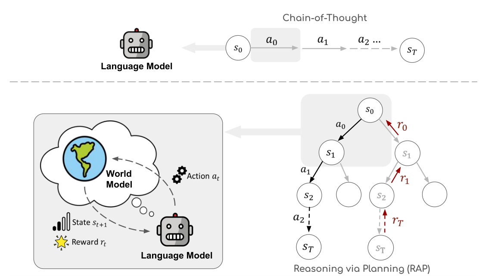
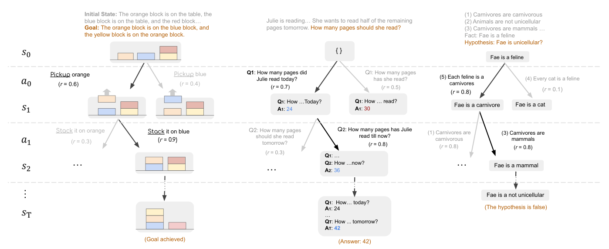
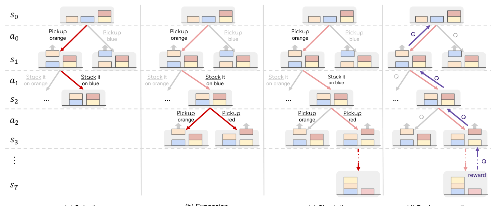
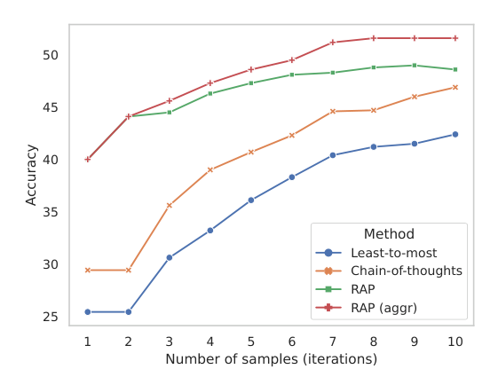
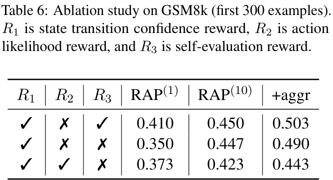
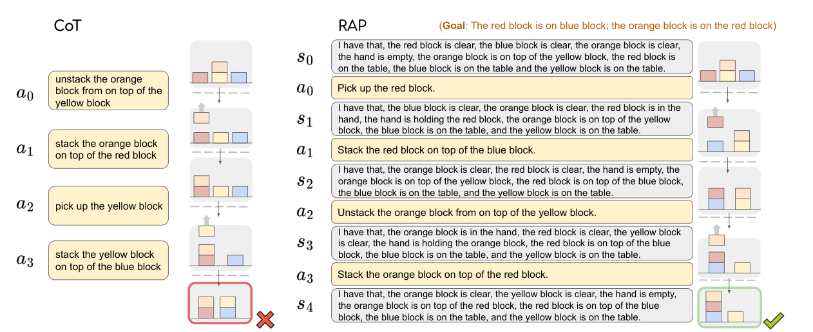

# RAP: Reasoning with Language Model is Planning with World Model

## 元信息

| 项 | 内容 |
| --- | --- |
| 标题 | Reasoning with Language Model is Planning with World Model |
| 框架名 | RAP（Reasoning via Planning） |
| 作者 | Shibo Hao\*、Yi Gu\*（equal contribution）、Haodi Ma、Joshua Jiahua Hong、Zhen Wang、Daisy Zhe Wang、Zhiting Hu |
| 单位 | UC San Diego；University of Florida；Mohamed bin Zayed University of Artificial Intelligence |
| arXiv / 发表 | PDF 页脚为 `arXiv:2305.14992v2 [cs.CL] 23 Oct 2023`。**注意**：项目计划文档/任务说明里写的 2305.14981 与 PDF 不符，引用时以 2305.14992 为准。会议：项目记录为 EMNLP 2023，PDF 全文未出现会议名（`待核对`） |
| 代码 / 数据 | `https://github.com/Ber666/llm-reasoners`（脚注 1）。数据：Blocksworld（Valmeekam et al., 2022/2023）、GSM8K、PrOntoQA（官方生成脚本采样 500 例） |
| 主力模型 / 算力 | 默认 LLaMA-33B（采样温度 0.8）；完整 Blocksworld 用 Llama-2 70B；对照 CoT(GPT-4)。全部实验跑在 4 × NVIDIA A5000 24GB；生成上限 2048 token 或遇 newline 截断 |

## 一句话总结

RAP 把**同一个冻结 LLM** 用两套 prompt 分别当作 reasoning agent（出 action）和 world model（预测下一文本状态 + 估 reward），把推理显式写成 MDP，再用改造过的 MCTS 在 `(s, a, s', r)` 树上做探索/回溯，从而替代 CoT 的一次性自回归生成；在 Blocksworld 上 LLaMA-33B + RAP 超过 GPT-4 + CoT（相对提升 33%）。

## 问题设定与动机

**CoT 式直接生成为什么不够。** 论文指出三个缺陷：(1) 缺少内部 world model 去模拟世界状态（方块布局、中间变量取值）；(2) 缺少 reward 机制去评估并引导推理走向目标状态；(3) 由前两点导致无法在巨大推理空间中平衡 exploration 与 exploitation。CoT 是"一次性"生成整条 chain，步数越多越容易引入额外错误；作者引 Valmeekam et al. (2022)：GPT-3 在 Blocksworld 类任务成功率仅 1%，人类 78%。

**"reasoning = planning with a world model" 的框架。** 人类靠 mental model 模拟动作后果再做 deliberate planning（探索备选动作序列、rollout 未来情景、据评估迭代修正计划）。RAP 的做法是把 LLM 自身改造成这个模拟器：agent 采样 action，world model（同一 LLM）预测 `s_{t+1}`，估计的未来 reward 回传更新对当前步骤的"信念"，驱动回溯与替代路径探索。关键一句：整条 reasoning trace 是 LLM 内部自模拟出来的，**不与外部真实环境交互**（"resembles humans contemplating a possible plan in their minds"）。

**与同期搜索类方法的差别（作者主张）。** CoRe 微调生成器+验证器配 MCTS 解码；ToT（Yao et al., 2023）同期工作用启发式 depth-/breadth-first 搜索；RAP 的差异化在于**形式化地引入 world model，并把 state / action / reward 统一进一个规划框架**。LLM+P 一类 code-based planning 受限于窄域与环境，RAP 可处理 open-domain（math/logic）。

## 方法

### LLM-as-world-model 的形式化

推理过程定义为 MDP：给定 `s_t`（初始 `s_0` 已知），LLM（agent）从生成分布采样 action：`a ~ p(a | s_t, c)`，`c` 为含 in-context demonstration 的 prompt；action 选定后，**同一个 LLM 换 prompt `c'`** 得到状态转移分布 `p(s_{t+1} | s_t, a_t, c')`。于是推理 trace 是状态与动作交错的序列 `(s_0, a_0, s_1, …, a_{T-1}, s_T)`，而 CoT 只有动作序列 `(a_0, a_1, …)`。

**两种能力来自一个模型**：next-state prediction 与 reward/value estimation 都只是同一份冻结权重上的不同 prompt 用法（action likelihood 取 token 的 log-prob、self-evaluation 取 "Yes" 的 next-word probability、state confidence 取多次采样的一致性），没有训练、也没有独立的 value network。这是 RAP 相对 MBRL 世界模型（Ha & Schmidhuber、MuZero 等）的核心简化，也是它成本结构的根源。

*Fig 1：CoT 只输出动作链；RAP 在树中同时维护 state 与 reward，世界模型由 LM 自身 repurpose 而来。*

### 各域的 state / action / reward 实例化

| 域 | state | action | 转移如何实现 | 终止条件 |
| --- | --- | --- | --- | --- |
| Blocksworld | 方块当前配置（自然语言 "I have that, …" 谓词清单：clear / on table / on top of / in hand） | 4 个动词之一（STACK / UNSTACK / PUT / PICKUP）+ 操作对象 | 在**当前合法动作集合**（由 domain 限制 + 当前布局过滤）中，让 LLM 预测"相关方块的状态变化"，再按规则把新条件加入、删除失效条件 | 满足 goal 全部条件，或达到树 depth limit |
| GSM8K | 中间变量的取值（子答案集合） | 提出一个增量的 sub-question（针对某个未知中间变量） | world model 依据已有变量与题干回答该子问题，把新值并入 state | 子问题可回答原问题（"Now we can answer the question:"） |
| PrOntoQA | 当前聚焦的 fact（类比人类 working memory） | 从 fact/rule 集中选一条规则做下一步演绎 | world model 做 **one-hop reasoning** 得到新 fact 作为 next state | 推出 hypothesis 或 dead end |

*Fig 2：三个域的 state/action 实例化与节点上的 reward 标注（Blocksworld 左、GSM8K 中、PrOntoQA 右）。*

### Reward 设计（四类，可组合）

1. **Likelihood of the action**：给定 state 与 prompt 下该 action 的 log probability，反映 LLM 的"直觉"，也可作探索先验。
2. **Confidence of the state**：world model 多次采样答案，取**最高频答案的占比**作为置信度。
3. **Self-evaluation by the LLM**：问 "Is this reasoning step correct?"，用 token "Yes" 的 next-word probability 作 reward（"识别错误比避免错误更容易"）。
4. **Task-specific heuristics**：如 Blocksworld 中把预测状态与 goal 比较，按满足的条件数给分（全部满足给 "super large reward" 保证该 plan 被选中）。

域内组合：Blocksworld 用 `r1`（action likelihood）+ `r2`（goal 条件数）；GSM8K 用 `r_t = r_{t,1}^α · r_{t,2}^{1-α}`（self-evaluation 与 state confidence 的加权几何平均）；PrOntoQA 只用 self-evaluation（few-shot 带 label 教 LLM 判断步骤质量）。

### RAP-Aggregation

只需最终答案的任务（GSM8K）可把多次 MCTS 迭代产出的 trace/答案做集成；需要完整推理链的任务（plan generation、logical inference）**不启用**。

## MCTS 规划细节

树中**节点 = state，边 = action + 一次状态转移**。维护 `Q : S × A → R` 估计在 s 执行 a 的期望未来 reward。Algorithm 1 的输入：`s_0`、转移函数 `p_θ`、reward 函数 `r_θ`、动作生成器 `p_φ`、每节点生成动作数 `d`、深度上限 `L`、roll-out 次数 `N`、探索权重 `w`。

*Fig 3：单次迭代的四个阶段（(a) Selection (b) Expansion (c) Simulation (d) Back-propagation）。*

算法步骤（按 Algorithm 1 + §3.3 整理）：

1. 初始化动作集 `A(s)`、子节点映射 `c(s,a)`、reward `r(s,a)`、`Q`、访问计数 `N(s)`。
2. 对 `n = 0 … N-1` 次迭代：
3. **Selection**：从 root（`N(s)>0` 时）逐层向下，按 UCT 选择
   `a* = argmax_{a∈A(s)} [ Q(s,a) + w · sqrt( ln N(s) / N(c(s,a)) ) ]`  （式 1）
   每访问一次即 `N(s) += 1`，直到到达当前树的 leaf。未访问过的 action 先用 **lightweight local reward（如 self-evaluation）估 Q 作为先验**再走 UCT——这是针对"迭代预算极有限"的关键改动。
4. **Expansion**：在 leaf 状态上，LLM(agent) 采样 `d` 个候选 action，LLM(world model) 分别预测对应 next state，得到 `d` 个子节点，并同步算出各自的 `r`。若 leaf 已是 terminal，则跳过 expansion 直接进入 back-propagation。
5. **Simulation（rollout）**：从新节点起，每步生成 `d` 个候选 action 并**贪心取局部 reward 最大者** `a' = max_a r(s,a)`，用 world model 预测 next state，直到 terminal 或深度 `L`。为省算力，rollout 阶段丢弃高成本 reward 组件（如需要多次采样的 confidence），只用轻量 reward。
6. **Back-propagation**：沿 root→terminal 路径，用该节点之后所有未来 step 的 reward 聚合更新每个 `Q(s,a)`。GSM8K/PrOntoQA 用"未来平均 reward 的最大值"以抵消路径长度影响：`Q*(s_t,a_t) = max avg(r_t, …, r_l)`（式 2）。
7. 达到预设迭代数后终止，从树中取最终 trace。三种取法：(a) 从 root 贪心选最高 Q 到 terminal；(b) 取产生最高 reward 的那次迭代的完整路径；(c) 取访问次数最多的 leaf 及其 root-to-leaf 路径。**作者观察到 (b) 通常最好。**

超参实际取值：`N`（迭代数）在 Blocksworld 为 10 / 20（RAP(10)/RAP(20)），PrOntoQA 为 20；`d`、`L`、`w` 的具体数值**正文与附录均未给出（待核对，需查代码仓库）**。解码：temperature 0.8 随机采样，max length 2048 或 newline 截断。

## 实验与结果

### Plan generation（Blocksworld，LLaMA-33B）

测试用例按最小所需动作数分组：2-step 30 例、4-step 57 例、6-step 114 例，每题至多 5 个方块。Baseline 用 4 个带解示例的 CoT prompt（同 Valmeekam et al., 2022 设定）。

| Method | 2-step | 4-step | 6-step |
| --- | --- | --- | --- |
| CoT | 0.17 | 0.02 | 0.00 |
| CoT - pass@10 | 0.23 | 0.07 | 0.00 |
| CoT (GPT-4) | 0.50 | 0.63 | 0.40 |
| RAP(10) | 1.00 | 0.86 | 0.26 |
| RAP(20) | 1.00 | 0.88 | 0.42 |

*Table 1*。RAP 平均成功率 64%；6-step 搜索空间可达 `5^6`，20 次迭代内仍能解出 42%；LLaMA-33B + RAP 相对 GPT-4 + CoT 提升 33%。"pass@10" 指每题采 10 个 plan、有一个正确即算解出；RAP 与其余设置都只评估单个 plan。

### 更复杂问题（完整 Blocksworld 602 例，Llama-2 70B）

| Setting | Method | 2 | 4 | 6 | 8 | 10 | 12 | All |
| --- | --- | --- | --- | --- | --- | --- | --- | --- |
| Easy | CoT | 0.49 | 0.18 | 0.06 | 0.01 | 0.01 | 0.00 | 0.08 |
| Easy | RAP(10) | 1.00 | 0.99 | 0.75 | 0.61 | 0.32 | 0.32 | 0.65 |
| Hard | CoT | 0.22 | 0.14 | 0.02 | 0.02 | 0.00 | 0.00 | 0.05 |
| Hard | RAP(10) | 0.67 | 0.76 | 0.74 | 0.48 | 0.17 | 0.09 | 0.51 |

*Table 4*。Easy = 已知每题最小动作数、从同动作数分组里随机取 10 例做 demo pool；Hard = 从全集随机取 10 例做全局 demo pool，推理时都随机采 4-shot。RAP 用的是改进版 prompt（Appendix E 的 adaptive prompting）。≥6 步时 CoT 断崖式下跌而 RAP 保持相对高位。

### Math reasoning（GSM8K）

| Method | Accuracy (%) |
| --- | --- |
| Chain-of-Thought | 29.4 |
| + SC(10) | 46.8 |
| Least-to-Most | 25.5 |
| + SC(10) | 42.5 |
| RAP(1) | 40.0 |
| RAP(10) | 48.6 |
| + aggr | 51.6 |

*Table 2*（所有方法共用同一 4-shot 示例）。注意正文写 "answers 48.8%" 与表中 48.6 不一致（原文自身笔误）。RAP 只选**一条** trace 就超过 CoT/L2M 的 self-consistency 版本，aggregation 再提升约 3 个百分点。

*Fig 5：GSM8K 上随采样数/迭代数变化的准确率。端点可由 Table 2 锚定：RAP 40.0(1)→48.6(10)、RAP(aggr) 40.0→51.6、CoT 29.4→46.8(10 samples)、L2M 25.5→42.5。RAP(aggr) 在**所有**预算下都优于 baseline，说明少量预算时 reward 引导的搜索找路径更可靠。*

### Logical reasoning（PrOntoQA）

| Method | Pred Acc | Proof Acc |
| --- | --- | --- |
| CoT | 87.8 | 64.8 |
| CoT + SC | 89.8 | - |
| RAP | 94.2 | 78.8 |

*Table 3*。设置："true" ontology、"random" rule ordering，混合 3/4/5-hop 样本防止 LLM 记住何时收尾，采 500 例，MCTS 20 次迭代、SC 20 次采样。RAP 比 CoT 高 14% proof accuracy、比 CoT+SC 高 4.4% prediction accuracy。

### Reward 消融

Blocksworld（Table 5；R1 = action likelihood，R2 = task-specific，R3 = self-evaluation；具体子集/模型设置正文未说明，`待核对`）：

| R1 | R2 | R3 | Success |
| --- | --- | --- | --- |
| ✓ | ✓ | ✗ | 0.88 |
| ✓ | ✓ | ✓ | 0.91 |
| ✓ | ✗ | ✗ | 0.46 |
| ✗ | ✓ | ✗ | 0.21 |
| ✗ | ✗ | ✓ | 0.14 |
| ✗ | ✗ | ✗ | 0.02 |

GSM8K 前 300 例（Table 6；R1 = state transition confidence，R2 = action likelihood，R3 = self-evaluation）：

| R1 | R2 | R3 | RAP(1) | RAP(10) | +aggr |
| --- | --- | --- | --- | --- | --- |
| ✓ | ✗ | ✓ | 0.410 | 0.450 | 0.503 |
| ✓ | ✗ | ✗ | 0.350 | 0.447 | 0.490 |
| ✓ | ✓ | ✗ | 0.373 | 0.423 | 0.443 |

结论：组合多 reward 更好；**action likelihood 对 plan generation 是 essential（只留 task-specific 时 0.88→0.21，只留 likelihood 时 0.88→0.46），但对 math 反而有害**——在 confidence 之上加 R2 时 RAP(1) 提升（0.350→0.373）、RAP(10) 却下降（0.447→0.423），作者解释是 math 步骤是自由自然语言、likelihood 被无关 token 干扰；Blocksworld 单步格式固定（PICK/PUT/STACK…）故 likelihood 判别力强。self-evaluation 在 math 上整体最优（R1+R3 行 0.410/0.450/0.503），是"高效且廉价的探索先验"；但在 Blocksworld 上单独只有 0.14，因为判断某候选动作好坏本身就需要多步推理。

## Prompt 设计

- **Blocksworld prompt 两套**。(a) *action likelihood / CoT baseline*：开头列出 4 种动作 + 9 条自然语言限制（一次只能拿/取一块、hand 必须为空才能 pick/unstack、stack 目标需 clear、拿起即 holding、放下/叠放后 hand 变空等），随后 4 个 `[STATEMENT] … My plan is as follows: [PLAN] … [PLAN END]` 示例，用 `<initial_state>` / `<goals>` 占位实例化测试题；**同一 prompt 既用于 CoT，也用于给 RAP 计算 `r1`**。(b) *next-state（world model）*：同样的规则前缀 + 指令 "After being given an initial state and an action, give the new state after performing the action."，2 个 few-shot 场景，格式 `[STATE 0] → [ACTION] → [CHANGE] → [STATE 1]`，即**先显式生成状态增量（delta）再输出完整新状态**，第 3 个场景用 `<state>` / `<action>` 占位。
- **GSM8K prompt**：**一个 prompt 同时承担 action proposal 与 next-state prediction**。指令要求把问题分解为 sub-question、每个答案写成完整句子并以 "The answer is" 结尾、当原问题可答时以 "Now we can answer the question: " 开头；4 个 shot。实例化 `<question>` 后追加前缀 `Question 5.1` 采第一个 action；后续 action 与 state 都靠把此前所有 sub-question/sub-answer 按 demo 格式追加进 prompt 来生成。
- **PrOntoQA prompt**：action proposal、action likelihood、next-state prediction 三用。要求 "copy the exact sentences in the facts. Do not change any wording. Do not create your own words."，6 个 shot，格式 `Facts k / Query k / Claim k.j / Next k.j`，终止符号为 `Finish.`。
- **prompt 敏感性 / 错误累积**：论文没有系统的 sensitivity 消融，但有两处直接证据。(1) Appendix E *Adaptive Prompting*：预测出的新状态会把剩余任务重述成一个"最小动作数更小"的新测试例，与 demo 分布错配，显著影响性能；缓解办法是**预先算好 demo 的中间状态**，推理时按当前树深度从开头截断 demo trace，使示例的最小动作数随搜索加深而下降——作者称对更难问题提升显著。(2) §4.1 第 (3) 点：计算 `r_t` 时**只喂当前 state、隐藏历史**，把 `s_2` 当成"新"测试例的初始状态，显著降低最后几步难度、把迭代预算省给前几步的困难决策。副作用是：一旦中间 state 预测错，后续步骤就在"自造的假初始状态"上继续，属于隐式的误差传播通道（论文未量化累积率）。

## 局限与失败模式

**作者自述（Limitations）**：只用 frozen LLM，能力被预训练上限约束；未 fine-tune LLM 以更好地充当 world model（指 Xiang et al., 2023 方向）；未与外部工具结合（引 ToolkenGPT / Toolformer）。

**读者视角的额外局限（对本项目更重要）**：

1. **纯想象、无执行回路**：整条 trace 由 LLM 自模拟，从不与真实环境交互，因此不存在"预测 vs 实际观测"的校验，也就谈不上预测-执行失配的度量与修正。
2. **无 embodiment / 无感知**：state 是自然语言谓词清单，Blocksworld 虽是"具身式"任务设定，但没有视觉输入、没有连续动作/几何、没有真机；论文对"plan generation 对 household robots 重要"只是动机性引用。
3. **长 horizon 仍然很弱**：6-step RAP(20) 只有 0.42；完整 Blocksworld Hard 12-step 仅 0.09。
4. **reward 靠手工设计**：作者明确说组合是"heuristics + exploratory experiments"选的；self-evaluation 单独用只有 0.14（Blocksworld），说明 LLM 自评作为价值函数很不可靠。
5. **搜索成本随迭代线性上升且未报告**：`d`、`L`、`w` 未披露，token 开销、wall-clock、与单次 CoT 的成本对比都没有（`待核对`）。RAP 相对 GPT-4 的胜利是"33B + N 次迭代"对"4 + 1 次生成"的比较，成本口径并不对齐。
6. **状态更新是 LLM delta + 规则混合**：靠"加新条件、删失效条件"维护 state，delta 抽取错误会直接污染后续所有节点。且 open-domain 动作空间只能采样 `d` 个（Appendix A 改动 1），覆盖度受限，`d` 的敏感性未报告。
7. **原文数字自相矛盾**：GSM8K 正文 48.8 vs 表 48.6；Table 6 行文把"只用 confidence reward"错标为 row 1（实为 row 2）。引用时以表格为准。

**Fig 4 的 CoT vs RAP 对照**（同一目标：red on blue 且 orange on red）：

*CoT 直接给出 4 个动作（unstack orange from yellow → stack orange on red → pick up yellow → stack yellow on blue），先把次要目标 "orange on red" 完成，破坏了 "red on blue" 的前置条件，最终状态错误。RAP 在每一步之间插入完整的 state 描述（哪些 block clear、hand 是否空、谁在谁上面、谁在 table 上），先 pick red → stack on blue → unstack orange → stack orange on red，达成目标。*

作者归纳的三点增益：(1) 维护 world state 使当前**合法动作**可被识别，避免生成非法计划；(2) 能**回溯**并尝试其他路径——RAP 前几次迭代犯了和 CoT 一样的错，但搜索把它推去了别的分支；(3) reward 计算只看当前 state，把剩余问题"重置"为更简单的测试例。

## 与 TWAM 的关系

| 维度 | RAP | TWAM 路线二 | 差异是否构成本质创新 |
| --- | --- | --- | --- |
| 世界模型载体 | 单个冻结 LLM，双 prompt 复用（agent / world model） | 同样是现成 LLM 做文本状态预测器，替换 Reflective Planning 的 DDM 未来图像生成 | **否**。预测器换实现 + 换宿主框架，方法学上与 RAP 同构 |
| 预测内容 | 自然语言 next state（Blocksworld 谓词清单 / 中间变量值 / 新 fact） | 机器人动作执行后的文本世界状态 | **否**。RAP 的 Blocksworld state 已经是"环境状态"，且已经是纯文本 |
| 预测的用法 | 在 MCTS 的 expansion + rollout 中向前模拟，reward 回传更新 Q，选高 reward trace | 在"候选动作→预测未来→评估反思→改计划"闭环中提供评估依据 | **否**（若我们只是把 MCTS 搬进 RP 闭环，属于组合） |
| 决策搜索 | MCTS / UCT（式 1），Q 值回传，`N`=10/20 迭代 | RP 原生为多候选反思，非树搜索 | **部分**。"搜索策略不同"不是卖点，除非能证明在具身长时程上搜索预算-成功率有明确权衡曲线 |
| 任务域 | 合成 puzzle + math + logic，无感知、无执行 | 具身机器人操作（视觉观测、真机/仿真执行） | **是**，但只是"换了 benchmark"级别的差异，需要机制性支撑 |
| 与环境交互 | **完全不交互**，整条 trace 自模拟 | 预测→执行→观察真实结果，闭环 | **是**。这是最实的一条差异轴 |
| 预测-执行失配 | 不度量、不反馈、不重估 | 可作为显式信号（预测 state vs 实际观测 diff）驱动重规划/校准 | **是，目前最强的 novelty 候选**，但 RAP 未做≠我们做了就有贡献，需给出可量化机制 |
| 状态表示 | 自由文本（Blocksworld 有 domain 约束的 valid action 过滤 + 半规则化 state update） | 拟用 precondition/effect 结构化状态（参考文献 2） | **潜在是**：RAP 未强制可验证的结构化状态；若我们能把"预测的 add/delete list 与符号可行性校验"绑定成可证伪的预测器，则超出 RAP |
| 价值/评估来源 | LLM 自估（likelihood / confidence / self-eval）+ 任务启发式 | VLM/LLM 对预测未来打分 + 反思 | **否**，除非引入物理可行性、代价、风险等 LLM 自评之外的信号 |
| 成本对比 | 完全没有与视觉/生成式预测器的成本比较，`d/L/w` 与 token 开销未报告 | 明确要回答"文本预测是否比生成式视频预测更便宜且够用" | **是**。RAP 里连"一次 next-state 调用值多少"都没算，这是空白，但属于**实证/工程贡献**而非方法贡献 |
| 长时程证据 | 6-step 0.42、Hard 12-step 0.09 | 多阶段长时程操作 | **否**（RAP 自己也没解决；我们不显著更好就不能宣称创新） |
| 训练 | 无（frozen，仅推理期方法） | 可用真实执行数据微调/校准 TWM | **是**（RAP 的 Limitations 明确留了这个口子，也意味着这是"已知开放问题"而非我们的独占贡献） |

**RAP 已经覆盖掉的（不要当成我们的贡献）**：LLM 同时充当 world model 与 policy；用自然语言谓词描述环境状态并预测动作后果；把 state 显式写进推理 trace 以区分于 CoT；用 MCTS/UCT 在"预测出的文本状态"上搜索；用 LLM 自估 reward 评估预测状态好坏（含 goal-condition 启发式）；在 Blocksworld 上证明 state-grounded 搜索能避免非法动作并支持回溯。

**仍然开放的轴（TWAM 可下注处）**：(1) 具身操作域 + 感知输入 → 文本状态如何从视觉观测可靠 ground；(2) 预测与真实执行的 diff 作为一等公民信号（重规划、置信度校准、错误归因）；(3) precondition/effect 结构化、可验证的预测（预测出的 add/delete 必须满足动作 schema，违反即判预测失败）；(4) 与生成式未来预测的**成本-成功率同预算对比**；(5) 文本世界模型在真实机器人时间预算下的调用次数/延迟账本（RAP 明确没算）。

**引用口径建议**：写 related work 时应表述为"RAP 已把 LLM-as-world-model 与树搜索结合用于文本推理任务，但其世界模型从不与真实环境交互、状态为自由文本、且未在具身操作上验证；TWAM 关注的是……"，避免使用"首次将 LLM 用作世界模型进行规划"这类表述。

## 术语表

| 术语 | 含义 |
| --- | --- |
| RAP | Reasoning via Planning；把推理写成 MDP 并用 MCTS 搜索的 LLM 推理框架 |
| LLM-as-world-model | 同一个 LLM 换 prompt 后输出 `p(s_{t+1}\|s_t,a_t,c')`，即状态转移模型 |
| MDP 化推理 | state = 环境配置/中间变量/当前 fact；action = 动作指令/子问题/选规则；trace = `(s_0,a_0,s_1,…)` |
| CoT | Chain-of-Thought；一次性自回归生成整条动作链，无显式 state |
| Self-consistency (SC) / pass@10 | SC = 采多条链后按答案多数投票（RAP-Aggregation 是其对应物）；pass@10 = 每题采 10 个 plan、有一个正确即算解出（baseline 的放宽口径） |
| UCT / UCB | 式 (1)：`Q(s,a) + w·sqrt(ln N(s)/N(c(s,a)))`，exploitation + exploration |
| Q(s,a) | 状态-动作价值，由该节点之后所有未来 reward 聚合更新；式 (2) `Q* = max avg(r_t,…,r_l)` 用未来平均 reward 的最大值抵消路径长度影响（GSM8K / PrOntoQA） |
| Selection / Expansion / Simulation / Back-propagation | MCTS 四阶段：UCT 下探到 leaf / 采样 `d` 个 action 并各预测一个 next state / 贪心局部 reward 做 rollout 至 terminal / 回传更新 Q |
| rollout policy | RAP 用"生成 `d` 个候选取局部 reward 最大者"的贪心策略，且只用轻量 reward 组件 |
| `d` / `L` / `N` / `w` | 每节点动作采样数 / 深度上限 / MCTS 迭代数 / 探索权重；`N`=10 或 20，其余未披露（`待核对`） |
| 四类 reward | action likelihood（动作 log prob）、state confidence（多次采样最高频答案占比）、self-evaluation（"Is this reasoning step correct?" 的 "Yes" 概率）、task-specific heuristic（如按满足 goal 条件的数量给分，全满足给超大 reward） |
| Adaptive Prompting | 预计算 demo 的中间状态并按树深度截断 demo 前缀，缓解"剩余任务被重述为更简单问题"造成的分布错配 |
| Blocksworld / GSM8K / PrOntoQA | 积木规划基准 / 小学数学应用题 / 逻辑证明基准（RAP 三个域） |
| lookahead simulation | 不与真实环境交互、纯由世界模型向前模拟未来状态，RAP 与 TWAM 路线二的共同机制核心 |
