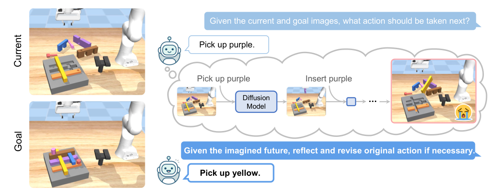
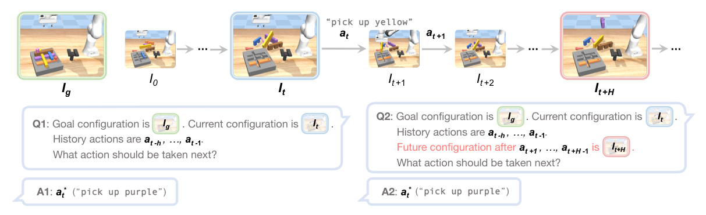
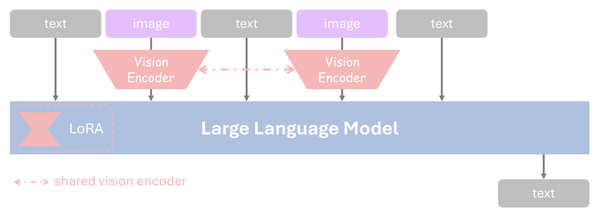
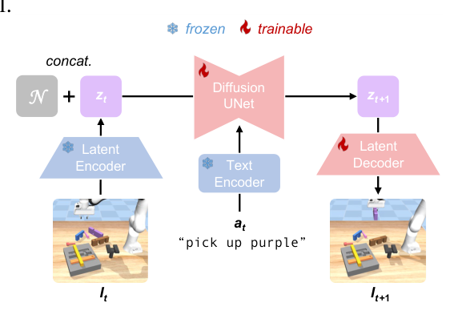
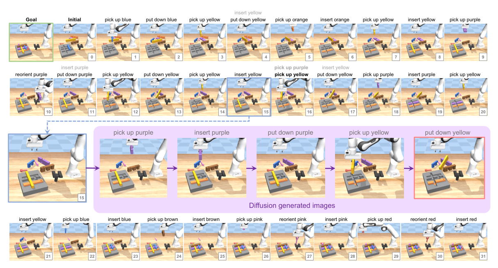
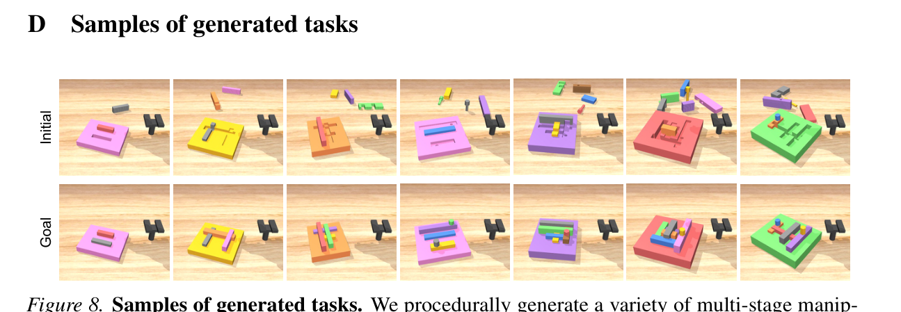
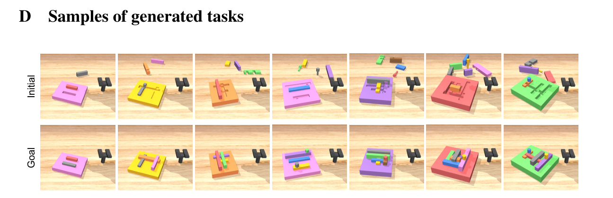
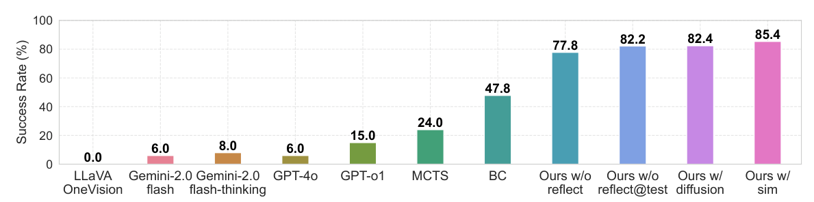
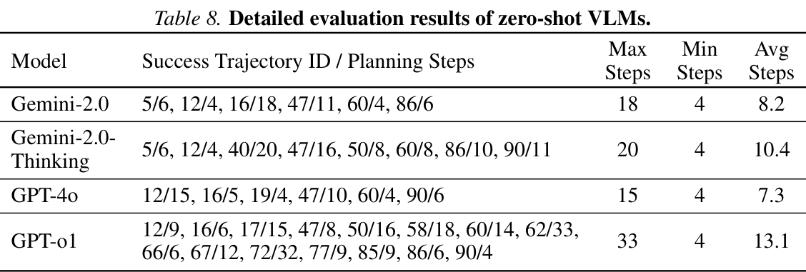
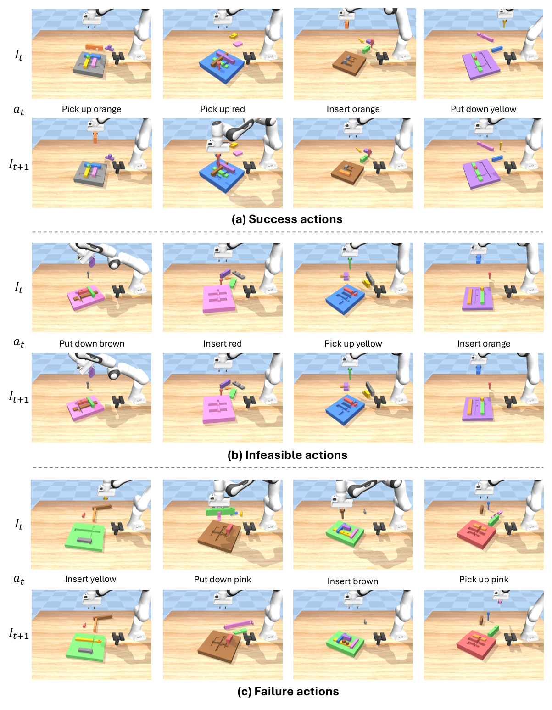

# Reflective Planning (ReflectVLM) — 研究笔记

> 用途：TWAM（Text World-Action Model）路线二的**改造基线**。本笔记按"数据流 / 模块边界 / 接口签名"精度撰写，便于最小改动替换 DDM 为 text world model (TWM)。

## 元信息

| 项 | 内容 |
|---|---|
| 标题 | Reflective Planning: Vision-Language Models for Multi-Stage Long-Horizon Robotic Manipulation |
| 作者 / 单位 | Yunhai Feng¹ (Cornell)、Jiaming Han²、Xiangyu Yue² (CUHK)、Zhuoran Yang³ (Yale)、Sergey Levine⁴、Jianlan Luo⁴† (UC Berkeley，† 项目导师；¹ 通讯 yunhaif@cs.cornell.edu) |
| 发表 | CoRL 2025（9th Conference on Robot Learning, Seoul）；arXiv:2502.16707（cs.RO）；具体 version 待核对 |
| 项目页 | https://reflect-vlm.github.io |
| 代码 | https://github.com/yunhaif/reflect-vlm （本地 `/home/czx/textworld-action-model-agent/reflect-vlm/`，HEAD `aa7ebb2`，最后提交 2025-07-17） |
| HF checkpoints | `yunhaif/ReflectVLM-llava-v1.5-13b-base`、`yunhaif/ReflectVLM-llava-v1.5-13b-post-trained`、`yunhaif/ReflectVLM-diffusion`（collection: `yunhaif/reflectvlm-…`） |
| License | 仓库 MIT（© 2025 Yunhai Feng，见 `LICENSE`）；内嵌 LLaVA 部分 Apache 2.0；env 部分改自 Metaworld / mjctrl |
| 训练代码 | **未开源**（README "Policy training: Coming soon…"），仅开源 rollout/eval 框架 `run.py` + 上游通用 `llava/train/train.py` |
| 依赖关键版本 | `torch==2.0.1`、`transformers==4.33.3`、`peft==0.4.0`、`diffusers==0.28.0`、`mujoco==3.1.2`、`huggingface-hub==0.21.4`（`pyproject.toml`） |

## 一句话总结

在测试时（test-time）让 VLM 先"提议动作 → 用扩散模型想象 H 步后的未来图像 → 看着想象结果自我批判并改写动作 → 只执行第一个动作"，用这套 reflective planning 闭环 + DAgger 式交互后训练，把 LLaVA-1.5-13B 在多阶段装配任务上的成功率从 47.8%（BC baseline）提到 82.4%（扩散想象）/ 85.4%（仿真想象），同时比 MCTS 快约 35 倍。

## 问题设定

- **形式化**：POMDP $(\mathcal{S},\mathcal{A},\mathcal{T},\mathcal{O},\mathcal{Z})$。$\mathcal{A}$ = 高层 skill $\{$pick up, insert, reorient, put down$\}\times\{$objects$\}$，每个 primitive 带失败率 $\epsilon$；$\mathcal{O}$ = RGB 图像；策略形式 $\pi(a_t\mid I_t, I_g)$（goal **image**-conditioned，不是 goal text）。
- **任务**：桌上 1 块 board + 若干小积木，把积木按序插满 board。多数任务含 **interlocking pieces**，因此存在**强制装配顺序**（dependency graph，Fig 4b：节点=物体，有向边=前驱须先装）。这构成"多阶段 + 长时域 + 物理约束"三重耦合。
- **为何要 multi-stage long-horizon**：单步正确不等于全程正确；评测集里存在"当前可执行但会把未来堵死"的动作，要求 agent 主动**拆掉已装好的件**再重规划（replanning）。
- **论文声称 prior work 缺的东西**：(1) 多数 VLM 规划器（PaLM-E / RT-2 / 各类）单步决策，不显式推理未来后果；(2) ReplanVLM / GameVLM 会重规划但依赖**symbolic state**，不是 visual imagination；(3) Black et al.（image-edit diffusion 驱动低层 policy）生成未来但**不用于反思/改计划**；(4) VLP（video language planning + beam search）受 prediction error accumulation 影响、物理推理弱；(5) TAMP 需要已知符号模型与显式状态估计，难以处理视觉输入与精细物理。
- **训练假设**：interactive imitation learning（DAgger 家族），训练期可访问 oracle 专家 $\pi_E(s)$（看得到全状态）；VLM 推理期只看图像。

## 方法总览

闭环 = **propose → imagine → evaluate → reflect → act**，其中 evaluate 与 reflect 融合在同一次 VLM 生成里（**没有独立 value function / 打分器**）。



**Alg. 2 Reflective Planning（推理）**，按代码实际执行顺序编号（H=5）：

1. $\tilde I_t \leftarrow I_t$（真实当前观测）。
2. $\tilde a_t \leftarrow \pi^{\text{propose}}_{\text{VLM}}(I_g, \tilde I_t)$（第一次提议，即"要被反思的原始动作"）。
3. for $k = 0 \dots H-1$：
   1. $\tilde I_{t+k+1} \leftarrow \tilde{\mathcal T}(\tilde I_{t+k}, \tilde a_{t+k})$ —— DDM 生成下一帧（$\tilde{\mathcal T}$ 是 learned proxy）；
   2. 若 $k+1 = H$ 则停；否则 $\tilde a_{t+k+1} \leftarrow \pi^{\text{propose}}_{\text{VLM}}(I_g, \tilde I_{t+k+1})$，history 拼上已生成的 plan。
      → 得到长度 H 的 plan $\tilde a_{t:t+H-1}$ 与"终帧" $\tilde I_{t+H}$。
4. $a_t \leftarrow \pi^{\text{reflect}}_{\text{VLM}}(I_g, I_t, \tilde I_{t+H}, \tilde a_{t:t+H-1})$：**同权重、不同 prompt 模板**，输出最终执行动作。
5. 在真环境执行 `env.act_txt(a_t)`，$t \leftarrow t+1$，回到 1（**每步都重规划**，无 commit）。

**Alg. 1 Interactive VLM Post-Training（训练）**：先在专家演示 $\mathcal D^*$ 上 SFT 出 base policy；然后 $K$ 轮迭代，每轮 rollout N 条轨迹，每步同时算 $a^{\dagger}_t\sim\pi_{\text{VLM}}$ 与 $a^*_t\sim\pi_E$，以概率 $p$ 执行 learner 动作、$1-p$ 执行专家动作（DAgger 混合）；轨迹结束后**relabel**：每个 timestep 造两条样本 (Q1,A1) 与 (Q2,A2)，损失为
$\min \; \mathbb E_{\mathcal D}[L_{CE}(\pi^{\text{propose}}_{\text{VLM}}(a_t|I_g,I_t),a^*_t) + L_{CE}(\pi^{\text{reflect}}_{\text{VLM}}(a_t|I_g,I_t,I_{t+H},a_{t:t+H-1}),a^*_t)]$。



> 关键：**反思监督信号来自"真实未来帧" relabel**（$I_{t+H}$ 由实际执行的动作序列导出，标签仍是 $a^*_t$），推理时才换成 DDM 生成的 $\tilde I_{t+H}$。训练/推理之间存在 train–test mismatch（真实图 vs 生成图）。

## 关键模块逐个拆解

### 1. VLM policy（$\pi^{\text{propose}}$ / $\pi^{\text{reflect}}$）

- 架构：LLaVA-v1.5 权重初始化；vision encoder `clip-vit-large-patch14-336` + LLM `vicuna-13b-v1.5`；**interleaved image/text 输入用同一个（shared）vision encoder** 编码后按位置拼回 token 序列；只训 LoRA（rank 128）。
- 输入：prompt 文本 + 图像列表，顺序**硬编码**为 `[goal_image, current_image]`（propose，2 个 `<image>`）或 `[goal_image, current_image, future_image]`（reflect，3 个 `<image>`）。
- 输出：纯文本动作串，形如 `pick up purple`；解析器 `parse_act_txt` 容忍 `"1. pick up red"` 这类编号前缀与 `done`。
- 训练配方：pre-train = 5,000 条 oracle 演示（1,000 个 task × 5 种初始摆放）；post-train = 每轮从 1,000 个 task 采 200 个、rollout 1k 条轨迹、共 3 轮；Table 6 参数：336px、LoRA rank 128、1 epoch、batch 128、AdamW、warmup 0.03 epoch、LR 5e-5 (BC) / 1e-5 (Iter.1,2,3)、weight decay 0.0、cosine。GPU 数量/训练时长论文未给（待核对）。



### 2. Diffusion Dynamics Model（DDM，$\tilde{\mathcal T}$）

- 定位：把 forward dynamics 当成 **image-to-image translation**：输入 $(I_t, a_t)$ → 输出 $\hat I_{t+1}$；单步模型自回归 rollout H 次得到 $\tilde I_{t+H}$。
- base model：**InstructPix2pix**（`timbrooks/instruct-pix2pix`），不从头训。
- 结构（Fig 3）：frozen latent encoder + frozen text encoder → $z_t, z_{a_t}$；Diffusion UNet 去噪（$z_t$ 与 noise $N$ 与 $z_{a_t}$ concat）→ latent decoder → $\hat I_{t+1}$。**UNet 与 decoder 可训练，encoder 冻结，两阶段可并行训**。
- 训练数据：生成 10K boards；用"加噪专家"采数据（以 $p\in\{0.2,0.5,0.7,0.9,1.0\}$ 把专家动作替换成随机动作）；50K 条轨迹（max length 50，成功即终止）≈ **1M transitions**；随机留 50K 做 eval，其余训练。
- Table 7：UNet 512px / 20K steps / batch 640 / lr 1e-4 / warmup 2K；decoder 512px / 4K steps / batch 160 / lr 1e-7 / warmup 1K；AdamW、wd 0.01、betas (0.9,0.999)、grad-norm 1.0、cosine。
- 推理超参（代码实测）：`num_inference_steps=50`、`image_guidance_scale=1.5`、`guidance_scale=10`、fp16、固定 `torch.Generator(seed=0)`；输入 resize 到 512×512 再 resize 回原尺寸（原图 640×480 → 存在长宽比失真）。



### 3. Reflection / self-critique 机制（机械上到底是什么）

- **"打分"不存在**：没有 critic head、没有 reward、没有数值评分。所谓 evaluation 是把 $\tilde I_{t+H}$ 作为**额外一张图**塞进 prompt，让同一个 VLM 以自然语言模板重新生成第一个动作。
- reflect prompt（App. I.2 / `roboworld/agent/utils.py:26-38`）核心三句：最近执行过的动作 `[history[-10:]]`、"模型计划的接下来 5 步是 `[plan]`，但只执行第一个"、"若整条 plan 顺序执行，未来状态将是 `<image>`"、结尾 "You can modify the initial plan if it leads to an undesired future state."
- 修正 plan 的产生方式：H 次 propose 生成 $\tilde a_{t:t+H-1}$；reflect 只输出**一个**动作并执行它（论文措辞"revise the plan"，代码里只取 revised 的 first action，剩余 plan 丢弃）。
- 兜底：若 revised 动作解析失败（非 4 个 primitive 之一 / 颜色不在表内），**静默回退为原始 propose 动作**（`run.py:289-296`）。
- 单轮（single-round）反思，不做多轮迭代；只看"终帧"，不看中间帧（受 context 限制，作者在 Limitations 中承认这妨碍 fine-grained credit assignment）。
- 定性示例：Fig 6 中 t=15 时先 propose `pick up purple`，看到生成未来"几乎没进展"后改为 `pick up yellow`。



### 4. 任务生成 / 环境

- 起点是 board 的 **voxel 3D array**（`Board._voxels`，`VOXEL_SIZE=0.01`；0=空、正整数=属于第几块砖、负值=hole），逐个 add brick：先采样 base board 尺寸，再采样每块砖的 size/position（约束：不越界 + 必须与已有砖相交），相交处产生"洞"，交叠的关键 voxel 分配给某一块 → 形成 interlocking。
- dependency 由 voxel 冲突直接推出：`update_voxels` 中 `self.dependencies.add((i, new_id))`（砖 i 须早于 new_id 处理）→ 传给 oracle 做前驱/后继判定。
- 颜色 9 种、形状表 `SHAPES` 15 种；砖的语言描述只有 `"{color} board" / "{color} block" / "{color} nail"`（`generator.py:744/801/818`）——**物体身份 = 颜色词**。
- MuJoCo + Franka；4 个 primitive 由 **rule-based script controller** 实现（`control_mode="script"`，assert 只允许 script）；`magic_attaching` 用 weld equality 模拟抓取。goal image 在 `reset_model` 里把全部 peg 直接摆到目标位姿后渲染 `table_back` 相机得到（640×480 offscreen）。
- 专家策略（App. G / Alg. 3）：基于每块砖的 6 种状态 `DONE / READY / BAD_B / BAD_D / BLOCKED_P / BLOCKED_S` 与全局 3 种状态 `DONE / READY / BAD_B` 查表决策；oracle 成功率 97%。




### 5. 评测协议

- 训练集 / 评测集分离：eval 集 **100 个未见 task**（不同配置、颜色、空间排布），统计见 Table 4：pieces 5–8（median 5，avg 5.53）、required actions 4–22（median 13，avg 12.13）。
- 难度分组（按 oracle 步数）：easy 0–9 步（24 个）、medium 10–14 步（60 个）、hard ≥15 步（16 个，max 22）。
- 指标：episode-level success rate；max decision steps = 50；zero-shot 商用 VLM 与 MCTS **只跑 1 seed**，其余 5 seeds 平均。
- 失败判定：50 步内 `env.is_success()`（每个 peg 的 `_align` site 与 `_hole_align` site 位姿误差 pos≤0.005 / quat≤0.02，nail 只查 pos + upright）未达成。

## 实验与结果

**主结果（Fig 5，100 tasks，Success Rate %）**



| 方法 | Success (%) | 备注 |
|---|---|---|
| LLaVA-OneVision | 0.0 | 指令跟随太差，无法抽取合法动作（App. J.1） |
| Gemini-2.0 flash | 6.0 | zero-shot，1 seed |
| Gemini-2.0 flash-thinking | 8.0 | zero-shot，1 seed |
| GPT-4o | 6.0 | zero-shot，1 seed |
| GPT-o1 | 15.0 | zero-shot 里最好，仅解简单 case |
| MCTS | 24.0 | VLM 提议 + 仿真 heuristic value |
| BC（base VLM，无 post-train） | 47.8 | 论文正文："pretrained VLM policy alone achieves 47.8%" |
| Ours w/o reflect（训练+推理都不用反思） | 77.8 | = Table 1 Iter.3 |
| Ours w/o reflect@test（训练用反思、推理不用） | 82.2 | = Table 1 Iter.3 |
| **Ours w/ diffusion（完整方法）** | **82.4** | = Table 1 Iter.3 |
| Ours w/ sim（上界，推理用真仿真器） | 85.4 | = Table 1 Iter.3 |

> 注：Fig 5 的 12 个 x 轴标签实际是 11 个柱（"LLaVA / OneVision" 是 LLaVA-OneVision 的换行），已用 PDF 文字坐标逐柱核对，与 Table 8 的 success 计数（6/8/6/15）和 Table 1 的 Iter.3 完全一致。

**Post-training 迭代（Table 1）**

| Method | Iter.1 | Iter.2 | Iter.3 |
|---|---|---|---|
| w/o reflect | 58.2 | 74.4 | 77.8 |
| w/o reflect@test | 64.4 | 76.0 | 82.2 |
| reflect w/ diffusion | 66.2 | 75.8 | 82.4 |
| reflect w/ sim | 66.8 | 75.4 | **85.4** |

**按难度（Table 3，mean of 5 seeds）**

| Method | Easy (24) | Medium (60) | Hard (16) |
|---|---|---|---|
| w/o reflect | 83.3 | 86.3 | 37.5 |
| w/o reflect@test | 85.8 | 88.7 | 52.5 |
| reflect w/ diffusion | 93.3 | 82.7 | 65.0 |
| reflect w/ sim | 97.5 | 85.0 | 68.8 |

→ 反思的价值几乎全部体现在 hard 组（37.5 → 65.0，+27.5 pt）；medium 组 diffusion 反而**低于** w/o reflect@test（82.7 vs 88.7）。

**算力 / 延迟（Table 2，单张 A100，wall-clock per step）**

| Method | Inference time (s) |
|---|---|
| Ours w/o reflect@test | 0.45 |
| Ours w/ diffusion | 11.10 |
| Ours w/ sim | 6.05 |
| MCTS | 391.42 |

→ 完整方法每步 ≈ 5 次扩散生成（50 denoise steps）+ 5 次 VLM decode，比 MCTS 快 ~35×，但比无反思慢 ~25×。**这是 TWAM 路线二必须正视的效率账**：换成 TWM 后若仍要 H 次 LLM 调用，延迟不会自动下降。

**其他可核对数字**：primitive 成功率（Table 5）pick up 98.4 / reorient 90.4 / insert 90.1 / put down 97.5（%）；oracle 97%；zero-shot 详情（Table 8）Gemini-2.0 6 成功 max/min/avg steps = 18/4/8.2、Thinking 8 → 20/4/10.4、GPT-4o 6 → 15/4/7.3、GPT-o1 15 → 33/4/13.1；MCTS 细节 $c_{\text{explore}}=0.5$、每节点 5 个 top-likelihood 动作、$V=\exp(-\lambda S),\ \lambda=0.1$、50 次迭代、每步重规划。



## 局限与失败模式

论文自陈（§7）：
1. 只用**最终未来帧**做反思（context 长度限制）→ credit assignment 粗；2. 只反思**单轮**；3. DDM 的 **compounding error**（长时域预测不稳，缺物理约束）；4. **纯仿真**，无真机；5. 生成模型对细微物理/时序理解不足 → diffusion 版低于 sim 版（82.4 vs 85.4）。

代码/实验层面的额外观察（本笔记补充）：
- 训练/推理不一致：反思训练时看真 $I_{t+H}$，推理时看 $\tilde I_{t+H}$。
- 反思失败静默降级为"无反思"，且 medium 组可能**变差**（82.7 < 88.7）→ DDM 误报会把对的计划改错。
- DDM 三类样例（Fig 16）：(a) 成功动作的预测基本正确；(b) **infeasible 动作**（如手里没砖却 `put down brown`）仍生成"看起来合理"的未来，不拒绝非法前置条件；(c) **低层执行失败**的 transition 上，预测帧仍呈现"动作成功"的样子并伴随几何/颜色 artifact → 系统性偏乐观，这正是反思信号被污染的来源。



zero-shot 失败案例（Fig 12–15，每格为一步，标注为模型输出动作）：
- **Fig 12（Gemini-2.0）**：steps 22–46 在 `pick up pink / put down pink / insert pink` 上无限循环，反复撞同一块不可插入的砖直到 50 步耗尽。
- **Fig 13（Gemini-2.0-Thinking）**：steps 10–46 围绕 orange 反复 `insert/pick up/put down`，中间还连续重复同一动作（17/18 都是 `insert orange`）→ 无法从失败中改变策略。
- **Fig 14（GPT-4o）**：steps 9–46 在 yellow/pink/red 间循环，且输出带句号（`insert yellow.`）等格式噪声；对"手里已握着砖却再 pick up"这类前置条件冲突无感知。
- **Fig 15（GPT-o1）**：前 18 步正确完成 6 块砖的 pick up→reorient→insert，随后 steps 19–45 **连续输出动作空间外的 `no action`**（合法动作只有 4 个 primitive + done），卡死到超时 → 即使强推理模型也会因指令跟随/动作空间约束失败而崩。

共性失败模式：(i) 动作级死循环 / 无 progress detection；(ii) 违反前置条件（hand 状态、dependency 顺序）；(iii) 输出格式越界；(iv) 看不到"这一步会让后面堵死"——即缺 forward reasoning，也正是 reflective planning 想补的能力。

## 代码结构与接口

| 论文概念 | 代码位置（已核对） | 说明 |
|---|---|---|
| Alg. 1 DAgger rollout + relabel 数据采集 | `run.py:149-427`（主循环 `run.py:227-342`） | `oracle_prob` = 论文里的 $p$（`run.py:48, 303-308`）；产出 `meta.csv`（`run.py:415-417`） |
| Alg. 2 推理闭环 | `run.py:253-280` | propose → imagine → reflect → 用 revised action |
| $\pi^{\text{propose}}$ / $\pi^{\text{reflect}}$ prompt 模板 | `roboworld/agent/utils.py:14-41`（`get_prompt(version, history, obj_labels, initial_plan=None)`） | `history[-10:]` = $h=10$；reflect 模板含 3 个 `<image>` |
| VLM policy | `roboworld/agent/llava.py:15`（`LlavaAgent`），`act` 在 `:52` | 上游 LLaVA 在 `llava/`；`process_images` `llava/mm_utils.py:28`，`tokenizer_image_token` `:43` |
| DDM $\tilde{\mathcal T}$ | `roboworld/agent/diffuser.py:12`（`DiffusionSim`），`forward` `:36` | 唯一"世界模型"入口，`StableDiffusionInstructPix2PixPipeline` `:19` |
| 想象 rollout（diffusion） | `run.py:90-115` `imagine_with_diffusion`，DDM 调用在 `run.py:95` | 返回 `(_plan, future_img)` |
| 想象 rollout（真仿真，上界） | `run.py:55-87` `imagine_with_sim`，状态快照/恢复 `env.__getstate__/__setstate__`（`franka_env.py:78-84`） | `diffuser_pretrained_model=None` 时走这条（`run.py:165-172`） |
| Expert policy $\pi_E$（Alg. 3） | `roboworld/envs/mujoco/franka/franka_assembly.py:403` `AssemblyOracle`；`get_action` `:512`；`get_all_feasible_actions` `:546`；`get_plan`（symbolic rollout）`:578`；`State` enum `:376` | `get_states()` `:635` 返回 `{描述: 状态名}` |
| Agent 包装层 | `roboworld/agent/oracle.py:4`（`OracleAgent.act` `:10`）、`random.py:3`、`gpt.py:16`、`gemini.py:10` | GPT/Gemini 为 zero-shot baseline，**`run.py:160` 的 assert 只允许 llava/expert/random**，需自行放开 |
| 程序化任务生成器 | `roboworld/envs/generator.py:825` `generate_xml(seed)`；`Board` `:541`；voxel 更新/依赖 `:609-653`；`generate_board` `:727` | `info` 含 `n_bodies / brick_descriptions / dependencies` |
| 环境 step / success | `franka_assembly.py:326` `act_txt`（颜色→body 名 `:331`）、`:349` `is_success`、`:100-134` `reset_model`/goal image 渲染 | 渲染 640×480（`mujoco_env.py:23`） |
| 配置系统 | `roboworld/utils/config.py:6` `define_flags`、`:28` `get_user_flags`（absl flags + ml_collections） | 所有 flag 在 `run.py:26-52` |
| MCTS baseline | **仓库中不存在**（grep 无 mcts/tree search 实现） | 无法复现 24.0% 与 391.42s |
| VLM 训练脚本（Alg. 1 的 finetune 部分） | **未开源** | 只有上游 `llava/train/train.py` |

**Agent 接口（精确签名）**

```python
# roboworld/agent/llava.py:52  —— 规划闭环真正使用的签名
def act(self, image, goal_image, inp, next_image=None,
        num_propose_actions=1, return_score=False, temperature=0) -> str
# image/goal_image/next_image: np.ndarray, shape (480,640,3) uint8 -> 内部转 PIL；返回动作字符串
# README 对外承诺的最小接口: def act(self, img, goal_img, inp) -> str
#   OracleAgent.act(image=None, goal_image=None, inp=None) (oracle.py:10) 兼容；
#   RandomAgent.act(candidate_objects, image=None, ...) (random.py:9) 不兼容，且 run.py 从未实例化它
#   （agent_type="random" 走 run.py:250 的内联随机）
```

`next_image` 就是**世界模型输出注入 VLM 的唯一通道**：`llava.py:60` 把它拼成 `process_images([goal_image, image, next_image])`，与 reflect prompt 里 3 个 `<image>` 占位符按顺序一一对应（`tokenizer_image_token` 按 `<image>` 切分插入 image token，**数量不匹配不会报错，只会静默错位**）。

**DDM 在规划中如何被调用**

```python
# run.py:95（在 imagine_with_diffusion 的 for i in range(FLAGS.imagine_future_steps) 里）
next_img = diffusion_sim.forward(curr_image=_img, act_text=_plan[-1])
# 输入: curr_image = np.ndarray, shape (480,640,3)（首步为真观测，之后为上一步生成图）
#       act_text   = str，例如 "pick up purple"
# 输出: np.ndarray 同尺寸图像（内部 512x512 生成后 resize 回去）
```

即 **DDM 是"单步、图像进 / 图像出、文本条件"的纯函数**，被自回归调用 H 次；它不接收 goal image、不接收 history、不返回分数。

**如何启动一次 run**

```bash
bash scripts/eval_reflect_vlm.sh diffusion   # 完整方法（DDM 想象）
bash scripts/eval_reflect_vlm.sh sim         # 上界（真仿真器想象）
bash scripts/eval_base_vlm.sh                # BC baseline (…-base checkpoint)
bash scripts/eval_expert.sh                  # oracle 上限
python scripts/interact.py --env_seed 1000001  # 手动玩 env
```

关键 flag（`scripts/eval_reflect_vlm.sh:29-45`）：`--agent_type=llava --revise_action=True --imagine_future_steps=5 --model_path=yunhaif/ReflectVLM-llava-v1.5-13b-post-trained --diffuser_pretrained_model=yunhaif/ReflectVLM-diffusion --seed=1000000 --start_board_id=1000000 --n_trajs=100 --level=hard --oracle_prob=0`。
⚠️ 开源脚本用 `--level='hard'`（`run.py:120`：`n_bodies>5` 才算 hard），**与论文"100 个混合难度任务"的评测集不同**；直接跑脚本得到的数字不能与 Fig 5 对齐。此外 `MUJOCO_GL=egl` 必需，`wandb` 会默认联网（`--logging.online=True`）。

## 对 TWAM 路线二的最小改造点

**唯一必须换的实现**：`roboworld/agent/diffuser.py:36` 的 `DiffusionSim.forward` + 其调用点 `run.py:90-115`（`imagine_with_diffusion`）。只要新 TWM 保持"`forward(state, act_text) -> state` 的单步纯函数 + 被自回归调 H 次"这一形状，Alg. 2 的其余部分（propose 循环、plan 组装、reflect 调用、执行、数据采集）可原样保留。

**替换件必须返回什么**：目前必须返回 `np.ndarray` 图像，因为 `run.py:96` 会 `Image.fromarray(next_img).save(...)`，且 `run.py:276` 把它作为 `next_image=` 传给 `LlavaAgent.act`。若返回文本，则**三处**要同步改：
1. `run.py:90-115` 循环里线程化的 `_img` 换成 `_state`（并去掉 `Image.fromarray` 存图，改为存文本/JSON）；
2. `roboworld/agent/utils.py:26-38` reflect 模板：第 3 个 `<image>` → `{future_state_txt}` 占位符（否则 `<image>` 数量与图片列表不匹配，会静默 token 错位）；
3. `roboworld/agent/llava.py:52-65`：`next_image=` → `next_text=`，把文本状态直接拼进 prompt（`process_images` 退回 2 图）。

**因为"图像条件"而会断掉的地方（诚实清单）**
- **想象中间步的 propose 依赖生成图像**：`run.py:105` 用 $\tilde I_{t+k+1}$ 再问一次 VLM。released checkpoint 从未见过"文本未来"作为输入（训练时 Q2 用的是真图 $I_{t+H}$），所以 TWM 版必须重新训练/至少做 prompt 层面的适配，不能指望零样本迁移。
- **没有任何打分/价值接口**：reflect 是生成式判断，不是 argmax over scores。TWAM 若想显式引入"未来状态评估器"，属于**新增模块**而非替换。
- **动作词表与状态词表耦合**：`run.py:130` 物体身份 = 颜色首词；`franka_assembly.py:331` `peg_colors.index(obj)` 找不到就抛异常；`run.py:290-296` 解析失败**静默回退原动作**。TWM 输出若用 `brick_3`/`the red block` 等不一致写法，会被无声吞掉，实验上表现为"退化成 w/o reflect@test"，很难 debug。建议改造时把 fallback 改成显式计数日志。
- **`imagine_with_sim` 与 `imagine_with_diffusion` 是两份重复代码、签名不同**（前者收 `env`，后者收 `diffusion_sim` 且多一个 `img` 参数），没有 world-model 抽象基类；`diffusion_sim` 只在 `if FLAGS.revise_action:` 分支里构造（`run.py:162-172`）。加 TWM 需要新增 `--world_model_type={diffusion,sim,text}` 之类的 flag，否则会撞上 `diffusion_sim = None → 走 sim` 的隐式语义。
- **`run.py:288` 的 `assert FLAGS.revise_action == (agent_action_revised is not None)`** 在 try 内，任何 agent 类型不匹配会直接终止整条轨迹；接新 agent（如纯 LLM 的 TWM planner）时先删/改这个断言。
- **数据侧缺口**：`meta.csv` 只记录真实 `image`/`next_image`（`run.py:391-392`）与 `agent_plan`/`agent_action_revised`，**不记录想象出的 $\tilde I_{t+H}$ 路径**（只以 `gen-*/sim-*` 文件名散落在 traj_dir）。TWAM 要为 TWM 造训练数据（预测 $s_{t+H}$）必须自己加列。
- **latency**：DDM 版 11.10 s/step 里含 5 次 50-step 扩散；TWM 若仍"每步 1 次 LLM 调用 × H + 1 次 reflect"，总 LLM 调用数从 6 涨到 6（propose 5 + reflect 1），并不省时间。想要"比 DDM 快"的卖点，应让 TWM **一次输出整段 H 步状态轨迹**（甚至一次输出 plan），把 loop 里的 H-1 次 propose 省掉——这会偏离 Alg. 2，需要在论文对比里明确标注为变体。

**text-state 表示的 2–3 个候选**
1. **枚举状态向量（推荐起步）**：直接复用 oracle 已有的符号状态——每块砖 ∈ {DONE, READY, BAD_B, BAD_D, BLOCKED_P, BLOCKED_S} + 全局状态 + in-hand 物体，格式化成一行 JSON/natural-language，例如 `in hand: none | red: DONE | blue: BLOCKED_P(pre: orange) | orange: READY | …`。优点：`AssemblyOracle.get_states()`（`franka_assembly.py:635`）+ `update_state_from_env()`（`:426`）可**零成本生成 ground-truth 标签**，TWM 训练数据直接从 rollout 的 oracle 状态序列里来；且 `get_plan(symbolic=True)`（`:578`）本身就是一个"完美文本世界模型"，可作为 TWM 的 oracle 上界（对应论文的 w/ sim）。缺点：丢了几何/姿态细节，无法表达"抓歪了""砖倒了"以外的信息；`get_plan` 会**就地修改** `self.state/in_deg`，用作 forward 模型时必须配 `get_oracle_state()/set_oracle_state()`（`:659/:666`）做快照。
2. **结构化属性文本（richer）**：每物体一行 `{color, type(block|nail), location(table|board|hand), pose(upright|down), predecessors:[…], successors:[…]}` + 少量几何摘要（voxel 尺寸/孔位）。介于 1 与图像之间，能表达 dependency graph 与"谁挡了谁"，也最接近 `brick_descriptions`/`dependencies` 这两个 `env_info` 已有字段（`run.py:140-143`）。成本：需要定义严格 schema，否则解析器要重写。
3. **程序化场景摘要 / scene-graph 文本 + 渲染回图**：TWM 输出文本状态后，用规则渲染器（voxel → 简图）转成图像再喂回 VLM，从而**完全不动** `LlavaAgent.act`/prompt 与 released checkpoint。优点：改动最小、可直接与 82.4% 对比；缺点：渲染图与 MuJoCo 渲染域差极大（模型见过的是 640×480 真实感图），预期掉点明显，只适合做 ablation 而不是主方法。

**建议的最小实验路径**：先做 (1)+`get_states()` 作为"oracle text world model"，跑通 `--world_model_type=text_oracle`，看能否复现 w/ sim 的 85.4% 量级（这一步只验证接口正确性，不验证 TWM 学习）；再把 oracle 换成 learned LLM-TWM，训练标签用 rollout 中相邻步的 `get_states()` 快照序列。

## 术语表

| 英文 | 中文释义 |
|---|---|
| Reflective Planning | 反思式规划：提议→想象未来→自我批判→改写动作的测试时闭环 |
| test-time computation | 测试时计算：不改权重，靠推理期额外计算（想象+反思）提升性能 |
| VLM policy | 视觉语言模型策略：图像+文本进、文本动作出 |
| Diffusion Dynamics Model (DDM) | 扩散动力学模型：以当前图+动作文本为条件生成下一帧的 learned forward model |
| InstructPix2Pix | 指令驱动图像编辑扩散模型，本文 DDM 的 base model |
| imagination horizon $H$ | 想象步长 / 规划时域（本文 5 步） |
| history length $h$ | 提示中携带的历史动作条数（本文 10） |
| action proposal / reflection | 动作提议 / 反思：同一 VLM 的两套 prompt 模板 |
| multi-stage long-horizon manipulation | 多阶段长时域操作：需按依赖顺序完成多个子目标 |
| interlocking pieces | 互锁积木：因几何交叠而存在强制装配先后 |
| dependency graph | 依赖图：节点=物体、有向边=前驱须先装配 |
| voxel representation | 体素表示：board 的 3D 整数数组，值为物体编号/0/负=孔 |
| pick up / insert / reorient / put down | 抓起 / 插入 / 重定向（借 fixture 摆正）/ 放下 |
| script controller | 规则式低层控制器（本文唯一支持的 `control_mode`） |
| oracle / expert policy | 专家策略：读全状态、查表决策，成功率 97% |
| DAgger-style interactive post-training | DAgger 式交互后训练：learner/专家动作按概率混合执行 |
| relabeling | 重标注：把轨迹里真实的 $I_{t+H}$ 补进上下文、标签仍用专家动作 |
| LoRA | 低秩适配，本文只训 rank-128 LoRA |
| MCTS (AlphaGo-Zero-style) | 蒙特卡洛树搜索基线：VLM 提议 + 仿真 rollout 估值 |
| success rate / episode-level | 成功率（100 个未见任务上的整轨成功比例） |
